<!-- 由 docs/solution-overview.html 生成（scripts/export_solution_md.py），请改 HTML 后重新导出 -->
<h1>日志审计平台 · 方案介绍</h1>

<i>面向 200+ 台 EC2 Linux 主机与 ALB / CloudTrail 的集中式日志审计 · AnyCompany POC · 2026-11</i>

<b>目录</b>：<a href="#s1">1. 方案概述</a> · <a href="#s2">2. 总体架构</a> · <a href="#s3">3. 核心流程时序</a> · <a href="#s4">4. 各类日志：采集 → 处理 → 查询分析（含主机日志详解）</a> · <a href="#s5">5. 数据存储与查询模型</a> · <a href="#s6">6. 智能问答</a> · <a href="#s6b">6b. 告警</a> · <a href="#s7">7. 安全与权限</a> · <a href="#s8">8. 演进路线与现状</a> · <a href="#s9">9. 平台界面操作指南</a>

<h2 id="s1">1. 方案概述</h2>

平台把分散在各区域 EC2 主机上的系统与应用日志，以及存放在 S3 上的 ALB 访问日志、CloudTrail 事件，统一纳入一个 Web 控制台，提供"资产纳管 → 日志采集 → 检索审计 → 分析问答"的闭环。全部基于托管 / 无服务器服务，无常驻服务器、无检索集群。

<table><tr><td><b>按区域纳管主机</b> 自动发现 EC2，标出 SSM 纳管状态，按标签批量纳管</td><td><b>可配置采集</b> 采集模板 + 自定义路径，通配符、journald、二进制日志转文本</td><td><b>实时 + 历史双通道</b> SSM 直连主机查当天日志；Athena 查 S3 历史日志</td><td><b>审计与分析</b> 10 个主机审计场景、12 个 ALB 报表、8 个 CloudTrail 预置查询、自然语言问答、每日告警</td></tr></table>
<table>
<tbody><tr><th style="width:22%">需求</th><th>方案</th></tr>
<tr><td>按区域罗列 EC2 主机</td><td>并发扫描所有已启用区域的 EC2 与 SSM 注册信息，区分 SSM 在线 / 离线 / 未注册 / 无实例角色，并给出接入指引</td></tr>
<tr><td>主机日志同步到 S3，路径可编辑维护</td><td>采集模板（内置 RHEL/AL2、Ubuntu、AL2023、Nginx、httpd 五套）+ 每台主机的自定义路径；每日北京时间 02:00 自动增量同步，也可手动触发</td></tr>
<tr><td>指定主机查询目录下的日志做审计</td><td>实时：经 SSM 在主机上列目录、tail、grep、解析 wtmp/btmp；历史：Athena 检索已同步日志；10 个预置审计场景一键执行</td></tr>
<tr><td>S3 上 ALB 日志的便捷查询分析</td><td>数据源（桶 + 前缀）可配置，一源一表；分析看板（趋势、Top IP、扫描识别、5xx、慢请求、地理分布等）+ 条件检索</td></tr>
<tr><td>补充</td><td>CloudTrail 审计、自然语言问答、每日告警（邮件 / 飞书 / 钉钉 / 企业微信）、管理员 / 普通用户、平台操作全量留痕、页面展示所执行的命令与 SQL</td></tr>
</tbody></table>

<h2 id="s2">2. 总体架构</h2>

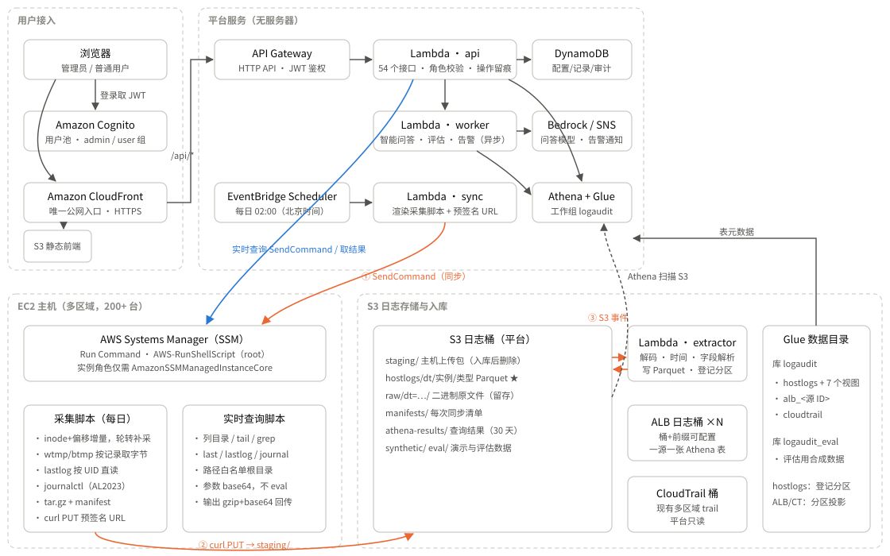

图 1 总体架构（橙色 = 每日同步链路 ①②③；蓝色 = 实时查询链路；Athena 统一查询 hostlogs / ALB / CloudTrail）

<h3>组件说明</h3>
<table>
<tbody><tr><th style="width:20%">组件</th><th>职责</th><th style="width:28%">关键设计</th></tr>
<tr><td>CloudFront + S3</td><td>前端静态页面与 <code>/api/*</code> 统一入口</td><td>S3 私有，经 OAC 访问；API 只经 CloudFront 暴露</td></tr>
<tr><td>Cognito</td><td>账号与登录；admin / user 两个组</td><td>管理员在平台内建用户、改角色、重置密码</td></tr>
<tr><td>API Gateway + Lambda api</td><td>主机、模板、同步、实时查询、Athena 查询、数据源、用户、审计等接口</td><td>JWT 鉴权；路由级角色要求；每次调用写操作审计</td></tr>
<tr><td>Lambda sync + Scheduler</td><td>每日定时 / 手动下发采集</td><td>为每台主机生成 1 小时有效的预签名 PUT URL，渲染脚本后 SendCommand</td></tr>
<tr><td>SSM Run Command</td><td>在主机上执行采集脚本与实时查询脚本</td><td>无需开放 SSH、无需在主机部署代理；跨区域可用</td></tr>
<tr><td>Lambda extractor</td><td>S3 事件触发：解码二进制登录记录、解析时间与字段、写 Parquet、登记分区</td><td>按主机时区换算；独立代码包（含 pyarrow）；回写同步状态</td></tr>
<tr><td>Athena + Glue</td><td>主机日志、ALB、CloudTrail 的 SQL 查询</td><td>分区投影免维护分区；单查询扫描上限 10 GB</td></tr>
<tr><td>Lambda worker + Bedrock</td><td>自然语言问答、评估运行、每日告警巡检</td><td>只读 SQL 守卫；该函数无 Glue 写权限</td></tr>
<tr><td>SNS + Scheduler</td><td>告警邮件通知；每日 03:00（北京时间）触发巡检</td><td>收件人需确认订阅；Webhook 由 worker 直接推送</td></tr>
<tr><td>Lambda SourceAccessFn</td><td>按已登记数据源生成 S3 只读策略</td><td>唯一权限是改写查询角色上的一条固定内联策略</td></tr>
<tr><td>DynamoDB</td><td>模板、主机配置、同步记录、数据源、操作审计、问答任务、评估结果</td><td>单表设计，按需计费</td></tr>
</tbody></table>

<h2 id="s3">3. 核心流程时序</h2>

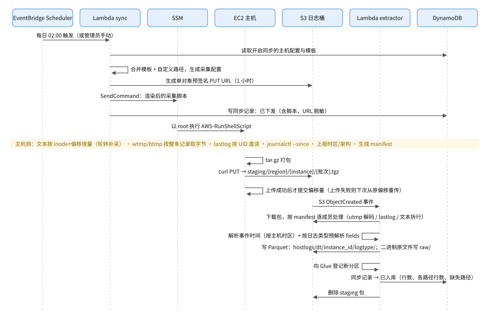

图 2 每日日志同步（采集 → 上传 → 入库）

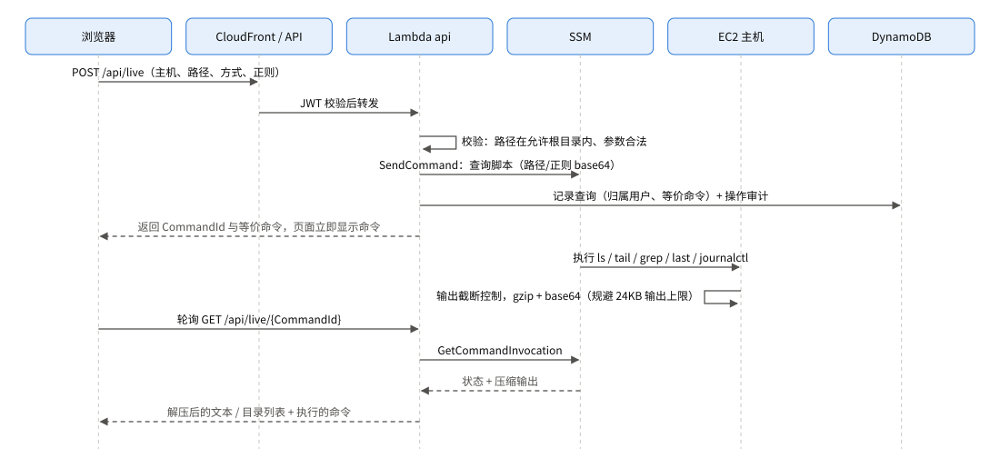

图 3 实时查询（指定主机、指定文件）

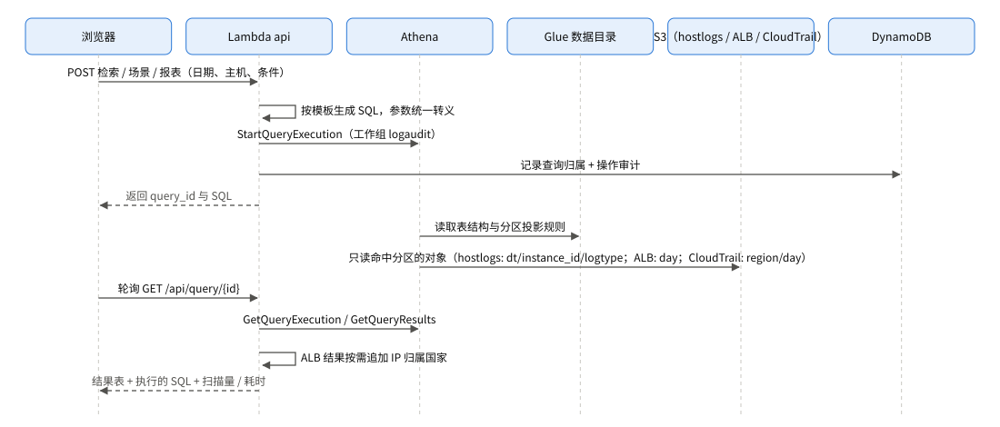

图 4 历史检索 / 审计场景 / ALB 报表 / CloudTrail 查询（Athena 异步查询）

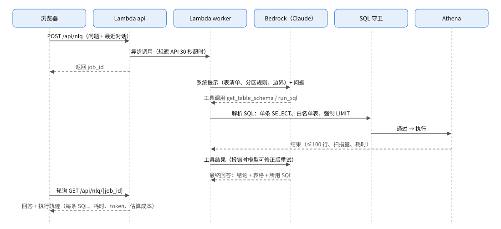

图 5 智能问答（自然语言 → 只读 SQL → 解释）

<h2 id="s4">4. 各类日志：采集 → 处理 → 查询分析</h2>

主机日志在采集与入库阶段走同一条链路，差异只在"主机侧怎么取"和"查询时怎么拆字段"。ALB 与 CloudTrail 日志本就由 AWS 写入 S3，平台不搬运，直接建表查询。

<h3>4.1 主机日志总览</h3>
<table>
<tbody><tr><th>日志</th><th>典型路径</th><th>主机侧采集</th><th>入库处理</th><th>查询分析（视图 / 场景）</th></tr>
<tr><td>身份认证与授权 <code>auth</code> </td><td><code>/var/log/secure</code>（RHEL/AL2） <code>/var/log/auth.log</code>（Ubuntu） <code>journal:sshd</code>（AL2023）</td><td>文本：inode + 字节偏移增量，轮转后补采旧文件尾部；journal：按时间窗口</td><td>syslog / ISO 时间 → <code>event_time</code>（无时区的按主机时区换算）；预解析 action、result、user、src_ip、port、method、command、run_as、target_user</td><td><code>v_auth</code>；场景：SSH 暴力破解、登录成功、root 直接登录、失败后成功登录、sudo 提权、账号与口令变更</td></tr>
<tr><td>系统审计 <code>audit</code> </td><td><code>/var/log/audit/audit.log</code></td><td>文本增量</td><td><code>msg=audit(epoch…)</code> → 时间；所有 <code>key=value</code>（含内层 <code>msg='…'</code>）展开到 fields，另给 action、result、user、src_ip</td><td><code>v_audit</code>；场景：auditd 登录失败、账号变更</td></tr>
<tr><td>登录记录 <code>login_wtmp</code> </td><td><code>/var/log/wtmp</code>（二进制）</td><td>按整条记录增量取原始字节（x86_64 384 字节 / aarch64 400 字节），<b>不依赖 last 命令</b></td><td>平台按 glibc <code>struct utmp</code> 解码：登录 / 注销 / 重启 / 运行级别，含用户、终端、来源、PID</td><td><code>v_login</code>；登录 / 注销历史、重启记录</td></tr>
<tr><td>失败登录 <code>login_btmp</code> </td><td><code>/var/log/btmp</code>（二进制）</td><td>同上</td><td>同上，action = failed_login</td><td><code>v_login</code>；场景：btmp 失败登录</td></tr>
<tr><td>最近登录 <code>lastlog</code> </td><td><code>/var/log/lastlog</code>（二进制）</td><td>按 UID 直接读取 292 字节记录（coreutils），<b>不依赖 lastlog 命令</b>，每次全量快照</td><td>每个账号一行：最近登录时间、终端、来源；从未登录记 never</td><td><code>v_lastlog</code>；长期未登录 / 从未登录账号盘点</td></tr>
<tr><td>定时任务 <code>cron</code> </td><td><code>/var/log/cron</code>、<code>journal:crond</code></td><td>文本增量 / journal</td><td>action（cmd_run、cmd_end、replace、begin_edit、end_edit、delete）、user、command</td><td><code>v_cron</code>；场景：定时任务变更</td></tr>
<tr><td>Web 访问 / 错误 <code>nginx_*</code> <code>httpd_*</code> </td><td><code>/var/log/nginx/*.log</code> <code>/var/log/httpd/*</code>、<code>/var/log/apache2/*</code></td><td>文本增量</td><td>访问日志：client_ip、method、url、status、bytes、referer、user_agent；错误日志：level、message、client_ip、request</td><td><code>v_web_access</code>、<code>v_web_error</code>；场景：Web 4xx/5xx 与可疑路径</td></tr>
<tr><td>系统 / 自定义 <code>syslog</code> <code>custom</code> </td><td><code>/var/log/syslog</code>、<code>/opt/app/logs/*.log</code> 等，支持通配符</td><td>文本增量</td><td>syslog 格式：host、program、pid、message；<b>JSON 行</b>：顶层字段全部展开到 fields</td><td><code>hostlogs</code> 直接查；关键字 / 正则 / <code>fields['键']</code></td></tr>
</tbody></table>

<h3>4.2 主机日志详解：如何上 S3、如何处理、Athena 如何建表与查询</h3>

整条链路分五段：<b>路径配置 → 主机侧采集 → 上传 S3 → 入库处理 → Athena 查询</b>。各类日志的差异只在"主机侧怎么取"（4.2.2）和"入库时怎么解析"（4.2.5）两处；入库后统一为同一张表，按日志类型提供视图。以下示例取自测试环境 la-web-01（Amazon Linux 2023，Graviton）的真实数据。

<h4>4.2.1 路径配置 → 采集指令</h4>

主机勾选的模板与自定义路径合并去重后，渲染成若干条采集指令，每条一行：<code>kind|二进制处理|日志类型|路径</code>。<code>kind</code> 由路径自动判定：

<table>
<tbody><tr><th style="width:26%">路径写法</th><th style="width:14%">kind</th><th>说明</th></tr>
<tr><td><code>journal:&lt;服务名&gt;</code></td><td>journal</td><td>从 systemd journal 取（AL2023 默认无 rsyslog，sshd / crond 日志只在 journal 里）</td></tr>
<tr><td>文件名以 <code>wtmp</code> / <code>btmp</code> 开头</td><td>wtmp / btmp</td><td>二进制登录记录</td></tr>
<tr><td>文件名以 <code>lastlog</code> 开头</td><td>lastlog</td><td>二进制最近登录表</td></tr>
<tr><td>其他任意路径，可含通配符 <code>*</code> <code>?</code> <code>[]</code></td><td>file</td><td>普通文本日志；通配符在主机上展开，匹配到几个文件就采几个</td></tr>
</tbody></table>

la-web-01（模板：Linux 安全基线 + Nginx）实际下发的指令：

<pre>file|text|auth|/var/log/secure
file|text|audit|/var/log/audit/audit.log
wtmp|text|login_wtmp|/var/log/wtmp
btmp|text|login_btmp|/var/log/btmp
lastlog|text|lastlog|/var/log/lastlog
file|text|cron|/var/log/cron
file|text|nginx_access|/var/log/nginx/access.log
file|text|nginx_error|/var/log/nginx/error.log</pre>

路径只允许字母、数字、<code>. _ - / @ +</code> 和通配符，禁止 <code>..</code>、空格、引号、<code>$</code> 等 shell 元字符；指令整体 base64 编码后嵌入脚本，由 SSM Run Command 以 root 执行。脚本只依赖 bash、coreutils、tar、gzip、curl。

<h4>4.2.2 主机侧：不同类型日志如何取</h4>
<table>
<tbody><tr><th style="width:12%">kind</th><th>处理方式</th><th style="width:32%">增量 / 去重</th></tr>
<tr><td>file</td><td>
① <code>stat</code> 取 inode 与大小；② 查状态文件中该路径上次的 inode 与偏移；③ 同一 inode 且未变小 → 从上次偏移读到末尾；④ <b>inode 变了（被轮转）</b>→ 在同目录查找 inode 与上次相同的旧文件（<code>.1</code>、<code>.0</code>、<code>-日期</code>，跳过已压缩的 .gz/.xz/.bz2/.zst），先补采它从上次偏移到末尾的部分，再从头读新文件；找不到则从头读新文件，并在清单中注明；⑤ 单次单文件上限 512 MB；⑥ 原样复制字节，不做格式处理</td>
<td>状态文件 <code>/var/lib/log-audit/offsets</code>，每行"路径 inode 偏移"： <code>/var/log/secure 8522473 42210</code> <code>/var/log/btmp 9561569 84000</code></td></tr>
<tr><td>wtmp / btmp</td><td>转文本：与 file 相同的增量和轮转逻辑，但<b>按整条记录对齐</b>取原始字节（<code>uname -m</code> 为 aarch64 时 400 字节，否则 384 字节），由平台解码；不依赖 <code>last</code>（Ubuntu 26.04 等新版本已不预装）。 原样：整个二进制文件复制一份；两者：都做</td>
<td>按字节偏移，天然不重不漏；上次同步时还在线的会话，之后的注销记录会作为新记录采到</td></tr>
<tr><td>lastlog</td><td>转文本：遍历 <code>getent passwd</code>，按 UID × 292 字节定位，用 <code>od</code> / <code>dd</code> 读出时间、终端、来源，输出为制表符分隔文本；原样：稀疏复制二进制文件</td><td>无增量，每次全量快照</td></tr>
<tr><td>journal</td><td><code>journalctl --utc -o short-iso -u &lt;服务&gt; --since "&lt;上次成功时间&gt;" --until "&lt;本次时间&gt;"</code>；服务名 <code>*</code> 表示全部</td><td>按时间窗口；首次取最近 7 天；上次成功时间存于 <code>/var/lib/log-audit/last_success</code></td></tr>
</tbody></table>

脚本还会上报主机时区（<code>timedatectl</code> → <code>/etc/localtime</code> → <code>/etc/timezone</code> → <code>date +%Z</code>，并附 <code>date +%z</code> 偏移）和 CPU 架构。路径不存在、命令缺失不会中断其他路径，只在清单里记 <code>missing</code> / <code>error</code>，同步记录页面显示"缺失：…"；发生轮转补采时显示"轮转补采：…"。

<h4>4.2.3 上传包结构</h4>
<pre>pkg.tgz
├── manifest.json                     ← 本次采集清单
├── files/var/log/secure              ← kind=file：本次新增字节（含轮转补采部分），保留原始路径
├── files/var/log/audit/audit.log
├── files/var/log/nginx/access.log
├── utmp/var/log/wtmp                 ← wtmp/btmp：本次新增的整条二进制记录
├── utmp/var/log/btmp
├── text/_var_log_lastlog.tsv         ← lastlog 解码结果（用户、UID、时间、终端、来源）
├── text/journal_sshd.txt             ← journal 导出文本
└── raw/var/log/wtmp                  ← 选择"原样 / 两者"时的二进制原文件（本例未选）</pre>

manifest.json（节选，真实数据）：

<pre>{"sync_id": "20261111-69e40b746d1c", "host_name": "ip-10-100-11-198...", "os": "amzn-2023",
 "arch": "aarch64", "utmp_size": 400, "tz": "UTC", "utc_offset": "+0000",
 "collected_at": "2026-11-11 14:42:14", "since": "2026-11-11 14:31:34",
 "entries": [
  {"kind": "file",    "logtype": "auth",       "path": "/var/log/secure",  "member": "files/var/log/secure",      "bytes": 33620, "status": "ok", "note": ""},
  {"kind": "btmp",    "logtype": "login_btmp", "path": "/var/log/btmp",    "member": "utmp/var/log/btmp",         "bytes": 84000, "status": "ok", "note": ""},
  {"kind": "lastlog", "logtype": "lastlog",    "path": "/var/log/lastlog", "member": "text/_var_log_lastlog.tsv", "bytes": 477,   "status": "ok", "note": "decoded"},
  {"kind": "file",    "logtype": "custom",     "path": "/var/log/app.log", "member": "files/var/log/app.log",     "bytes": 12, "status": "ok", "note": "rotated:/var/log/app.log.1+6B"},
  ...]}</pre>

<h4>4.2.4 上传与提交</h4>
<ol>
<li>平台为每台主机、每次同步生成一个只能写入单个对象、1 小时有效的预签名 PUT URL（S3 区域端点 + SigV4），随脚本下发。</li>
<li>主机执行 <code>curl -X PUT --upload-file pkg.tgz &lt;URL&gt;</code>，失败自动重试 3 次。主机不需要 S3 权限，也不需要 AWS CLI。</li>
<li>返回 HTTP 200 后，才把新偏移写回 <code>offsets</code>、把本次时间写入 <code>last_success</code>；上传失败则偏移不变，下次从原位置重采。</li>
<li>脚本最后输出一行 JSON（如 <code>{"status":"ok","bytes":12642,"entries":8}</code>），显示在同步记录的"执行的命令 → 主机返回"里。</li>
</ol>

<h4>4.2.5 入库处理（Lambda extractor）</h4>

上传包落到 <code>staging/{区域}/{实例ID}/{批次}.tgz</code> 后，S3 事件触发 extractor：

<ol>
<li>读取 manifest：主机时区、utmp 记录长度、各成员的类型。</li>
<li><code>raw/</code> 原样转存到 <code>raw/dt=…/{区域}/{实例}/{批次}/…</code>，不进 Athena。</li>
<li><code>utmp/</code> 按 glibc <code>struct utmp</code>（384 / 400 字节）逐条解码；<code>.tsv</code>（lastlog）逐账号转换；其余文本逐行读取（UTF-8，非法字节替换，跳过空行，单行截断到 16,000 字符）。</li>
<li>每行解析事件时间（规则见下表）；不带时区的格式按<b>主机时区</b>换算为 UTC；解析不到时沿用上一行的时间（多行堆栈归属到同一事件）。</li>
<li>按日志类型预解析常用字段写入 <code>fields</code>（见 4.2.7）；JSON 行把顶层字段全部展开。</li>
<li>按日志类型分别写 Parquet（Snappy 压缩，流式分批写入）：<code>hostlogs/dt={同步日期}/instance_id={实例}/logtype={类型}/{区域}_{批次}.parquet</code>，并向 Glue 登记新分区。</li>
<li>manifest 另存 <code>manifests/dt=…/</code>；同步记录更新为"已入库"（总行数、各路径与各类型行数、主机时区、缺失路径、轮转补采说明）；删除 staging 包。</li>
</ol>
<table>
<tbody><tr><th style="width:4%">#</th><th style="width:24%">时间格式</th><th style="width:38%">原文示例</th><th>适用日志</th></tr>
<tr><td>1</td><td>ISO 8601（带偏移直接换算；不带偏移按主机时区）</td><td><code>2026-11-11T09:54:24+0000 host sshd…</code></td><td>Ubuntu rsyslog、journalctl short-iso</td></tr>
<tr><td>2</td><td>auditd epoch</td><td><code>type=USER_LOGIN msg=audit(1794390393.302:7423): …</code></td><td>audit.log</td></tr>
<tr><td>3</td><td>传统 syslog（无年份、无时区：补采集年份，按主机时区）</td><td><code>Nov 11 09:54:26 host sshd-session[26129]: …</code></td><td>RHEL / AL2 的 secure、cron、messages</td></tr>
<tr><td>4</td><td>Common Log Format（自带时区）</td><td><code>10.0.0.1 - - [11/Nov/2026:10:00:01 +0800] "GET / …"</code></td><td>nginx / httpd access</td></tr>
<tr><td>5</td><td>nginx error（按主机时区）</td><td><code>2026/11/11 10:00:01 [error] …</code></td><td>nginx error.log</td></tr>
<tr><td>6</td><td>httpd error（按主机时区）</td><td><code>[Wed Nov 11 10:00:01.123 2026] [core:error] …</code></td><td>httpd / apache2 error_log</td></tr>
<tr><td>7</td><td>ctime（按主机时区）</td><td><code>root ssh:notty 10.100.11.105 Wed Nov 11 09:54:27 2026 …</code></td><td>旧版 last 文本</td></tr>
<tr><td>8</td><td>行内 ISO 时间</td><td><code>… 2026-11-11T09:54:27+00:00 …</code></td><td>其他含 ISO 时间的日志</td></tr>
<tr><td>—</td><td>二进制记录自带 epoch</td><td>utmp <code>ut_tv</code>、lastlog <code>ll_time</code></td><td>wtmp / btmp / lastlog（不经文本解析）</td></tr>
</tbody></table>

<h4>4.2.6 S3 落地结构与 Athena 建表</h4>

入库后的真实对象（测试环境，同步日期 2026-11-11）：

<pre>s3://logaudit-logs-example/hostlogs/dt=2026-11-11/instance_id=i-0a19649a02c450a79/logtype=auth/ap-northeast-1_20261111-c4bd0dc76fda.parquet
s3://logaudit-logs-example/hostlogs/dt=2026-11-11/instance_id=i-0a19649a02c450a79/logtype=login_btmp/ap-northeast-1_20261111-c4bd0dc76fda.parquet
s3://logaudit-logs-example/hostlogs/dt=2026-11-11/instance_id=i-0a19649a02c450a79/logtype=nginx_access/ap-northeast-1_20261111-c4bd0dc76fda.parquet
s3://logaudit-logs-example/manifests/dt=2026-11-11/ap-northeast-1_i-0a19649a02c450a79_20261111-c4bd0dc76fda.json</pre>

一行入库后的内容（btmp 解码结果，真实数据）：

<pre>logtype    = login_btmp          path = /var/log/btmp          event_time = 2026-11-11 09:54:27
line       = root     ssh:notty    10.100.11.105    Wed Nov 11 09:54:27 2026  type=USER_PROCESS pid=26129
fields     = {action=failed_login, result=failed, user=root, src_ip=10.100.11.105, tty=ssh:notty, ut_type=USER_PROCESS, pid=26129, session=0}</pre>

<b>一张表容纳所有格式</b>：表只定义统一外层，原文在 <code>line</code>，各格式字段在 <code>fields</code>。新增任何路径或格式都不用改表。平台部署时自动建表一次，分区由入库 Lambda 按需登记：

<pre>CREATE EXTERNAL TABLE logaudit.hostlogs (
  region string, host_name string, path string, line_no bigint, event_time string, line string,
  sync_id string, collected_at string,
  fields map&lt;string,string&gt;)                                         -- 入库时预解析的字段
PARTITIONED BY (dt string, instance_id string, logtype string)        -- 同步日期 / 实例 / 日志类型
STORED AS PARQUET                                                     -- 列式存储，只读查询用到的列
LOCATION 's3://&lt;平台日志桶&gt;/hostlogs/'
TBLPROPERTIES ('parquet.compression'='SNAPPY')</pre>
<table>
<tbody><tr><th style="width:22%">列</th><th>用途</th></tr>
<tr><td><code>dt</code>（分区）</td><td>同步日期，查询必须带；事件通常发生在同步当天或前一天，按事件日期查时放宽 1 天并用 <code>event_time</code> 精确过滤</td></tr>
<tr><td><code>instance_id</code>（分区）</td><td>按主机筛选时只读这台主机的文件</td></tr>
<tr><td><code>logtype</code>（分区）</td><td>按日志类型筛选时只读该类型的文件；跨系统统一（AL2023 的 <code>journal:sshd</code> 与 RHEL 的 <code>/var/log/secure</code> 都是 auth）</td></tr>
<tr><td><code>host_name / region / path</code></td><td>EC2 Name 标签、区域、原始路径</td></tr>
<tr><td><code>event_time</code></td><td>统一 UTC 时间字符串，可直接比较或 <code>CAST(event_time AS timestamp)</code></td></tr>
<tr><td><code>line</code></td><td>原始日志行，用于关键字检索、正则兜底、取证</td></tr>
<tr><td><code>fields</code></td><td>预解析字段，<code>fields['src_ip']</code> 方式取值</td></tr>
</tbody></table>

分区裁剪实测（同一条读取 <code>line</code> 列的查询，测试环境一天的数据）：

<table>
<tbody><tr><th>条件</th><th>扫描量</th></tr>
<tr><td>全部主机、全部类型</td><td>507 KB</td></tr>
<tr><td>单台主机</td><td>135 KB</td></tr>
<tr><td>单台主机 + logtype = auth</td><td>14 KB（约 1/36）</td></tr>
</tbody></table>

按日志类型的视图（把 fields 展开为同名列，平台部署时自动创建）：

<table>
<tbody><tr><th style="width:18%">视图</th><th style="width:28%">范围</th><th>展开的列</th></tr>
<tr><td><code>v_auth</code></td><td>logtype = auth</td><td>action, result, user, src_ip, port, method, program, command, run_as, target_user</td></tr>
<tr><td><code>v_audit</code></td><td>logtype = audit</td><td>action, result, user, src_ip, exe, op, terminal, uid, auid</td></tr>
<tr><td><code>v_login</code></td><td>login_wtmp + login_btmp</td><td>action, result, user, tty, src_ip, ut_type, pid</td></tr>
<tr><td><code>v_lastlog</code></td><td>lastlog</td><td>user, uid, last_login, tty, src_ip</td></tr>
<tr><td><code>v_cron</code></td><td>cron</td><td>action, user, command, target_user, program</td></tr>
<tr><td><code>v_web_access</code></td><td>nginx_access + httpd_access</td><td>client_ip, method, url, status, bytes, referer, user_agent</td></tr>
<tr><td><code>v_web_error</code></td><td>nginx_error + httpd_error</td><td>level, message, client_ip, request, module</td></tr>
</tbody></table>

每个视图另含 dt、instance_id、host_name、logtype、path、event_time、line、fields 列。

<h4>4.2.7 不同格式如何查询分析</h4>

优先用视图或 <code>fields</code>，无需写正则；<code>line</code> 原文始终可用作正则兜底。审计场景、告警和智能问答都基于这些写法。

<table>
<tbody><tr><th style="width:16%">日志</th><th>写法（均在测试环境实测通过）</th></tr>
<tr><td>auth：SSH 失败</td><td><pre>SELECT src_ip, "user", count(*) AS n FROM v_auth
WHERE dt = '2026-11-11' AND result = 'failed' GROUP BY 1, 2 ORDER BY n DESC</pre></td></tr>
<tr><td>auth：sudo</td><td><pre>SELECT event_time, host_name, "user", run_as, command FROM v_auth
WHERE dt = '2026-11-11' AND action = 'sudo'</pre></td></tr>
<tr><td>audit</td><td><pre>SELECT action, "user", src_ip, result, count(*) AS n FROM v_audit
WHERE dt = '2026-11-11' AND action LIKE 'user_%' GROUP BY 1, 2, 3, 4</pre></td></tr>
<tr><td>登录记录</td><td><pre>SELECT host_name, "user", src_ip, count(*) AS n, max(event_time) AS last_seen FROM v_login
WHERE dt = '2026-11-11' AND action = 'failed_login' GROUP BY 1, 2, 3</pre></td></tr>
<tr><td>lastlog</td><td><pre>SELECT host_name, "user", last_login, src_ip FROM v_lastlog
WHERE dt = '2026-11-11' AND last_login &lt;&gt; 'never'</pre></td></tr>
<tr><td>cron</td><td><pre>SELECT event_time, host_name, "user", action FROM v_cron
WHERE dt = '2026-11-11' AND action IN ('replace', 'delete')</pre></td></tr>
<tr><td>Web 访问</td><td><pre>SELECT url, status, count(*) AS n FROM v_web_access
WHERE dt = '2026-11-11' AND instance_id = 'i-0a19649a02c450a79' GROUP BY 1, 2 ORDER BY n DESC</pre></td></tr>
<tr><td>应用 JSON 日志</td><td><pre>-- 每行是 JSON 时，顶层字段已在 fields 中（写法示例，测试环境未部署此类应用日志）
SELECT fields['traceId'] AS trace, count(*) AS n FROM hostlogs
WHERE dt = '2026-11-11' AND path LIKE '/opt/app/logs/%' AND fields['level'] = 'ERROR' GROUP BY 1</pre></td></tr>
<tr><td>正则兜底</td><td><pre>SELECT event_time, host_name, line FROM hostlogs
WHERE dt = '2026-11-11' AND logtype = 'auth' AND regexp_like(line, 'Failed password|authentication failure')</pre></td></tr>
</tbody></table>

<h4>4.2.8 新增一类日志需要做什么</h4>
<table>
<tbody><tr><th style="width:4%">#</th><th>步骤</th><th style="width:32%">是否需要改表 / 改代码</th></tr>
<tr><td>1</td><td>在模板或主机的自定义路径中加路径，选一个日志类型（或 custom）</td><td>否</td></tr>
<tr><td>2</td><td>下次同步（每日或手动）后，即可按 <code>path</code> / <code>logtype</code> 查询；若每行是 JSON，字段自动进 <code>fields</code></td><td>否（新的 logtype 分区由入库自动登记）</td></tr>
<tr><td>3</td><td>时间格式不在 4.2.5 的规则内 → <code>event_time</code> 为空，按 <code>dt</code> 与关键字仍可查</td><td>需要按事件时间过滤时：extractor 加一条时间规则</td></tr>
<tr><td>4</td><td>需要结构化字段 → 在字段解析器中为该 logtype 加规则；需要固定统计 → 加一个审计场景（SQL 模板），可选纳入告警</td><td>是（小改动）</td></tr>
</tbody></table>

<h3>4.3 ALB 访问日志</h3>
<table>
<tbody><tr><th style="width:16%">环节</th><th>方式</th></tr>
<tr><td>采集</td><td>由 ALB 自身写入 S3（开启访问日志即可），平台不搬运。10+ 个 ALB 可分布在多个桶 / 前缀</td></tr>
<tr><td>接入</td><td>管理员在"数据源与设置"添加数据源：填写桶 + 前缀，平台自动探测账号与区域，或从"本账号已开启访问日志的 ALB"列表一键带入</td></tr>
<tr><td>处理</td><td>每个数据源建一张 Athena 表 <code>alb_&lt;ID&gt;</code>：RegexSerDe 解析 30+ 字段，按天（<code>day</code>）分区投影，无需 ETL、无需登记分区。 <b>新旧格式兼容</b>：ALB 日志自 2016 年起多次在行尾追加字段（域名/证书 → 规则/动作 → 重定向/错误 → 目标列表 → 分类 → 连接追踪 → 转换字段）。平台正则以各代共有的前 22 个字段为基础，之后按追加顺序逐段可选：旧格式缺失的字段为空，未来新增字段落入 <code>extra</code> 列，同一张表可混存不同年代的日志。看板中的「日志格式与解析率」报表按 ALB 显示各格式占比与解析失败行数。</td></tr>
<tr><td>查询分析</td><td>分析看板（12 个报表并行）：总览 KPI、请求与状态码趋势、P95 延迟、地理分布（DB-IP Lite 归属库）、状态码分布、疑似扫描 / 攻击来源、Top IP、Top URL、5xx 明细、慢请求、各负载均衡器、User-Agent、日志格式与解析率；条件检索：IP、状态码（如 5xx）、URL、方法、延迟阈值</td></tr>
</tbody></table>

<h3>4.3.1 ALB 日志如何能被 Athena 查询（建表机制）</h3>

Athena 不会自动识别 S3 上的文件，查询前必须在 Glue 数据目录里有一张<b>表定义</b>，说明"文件在哪、怎么切分成列、怎么按日期定位目录"。表定义只是元数据，不复制、不转换、不移动 S3 上的日志。

<table>
<tbody><tr><th style="width:18%">环节</th><th>做什么</th><th style="width:22%">谁来做 / 何时</th></tr>
<tr><td>① 登记数据源</td><td>管理员在「数据源与设置」填写桶 + 前缀；平台列出 <code>前缀/AWSLogs/</code> 下的目录，自动识别账号与区域</td><td>管理员，每个桶 / 前缀一次</td></tr>
<tr><td>② 自动建表</td><td>平台执行一条 <code>CREATE EXTERNAL TABLE alb_&lt;ID&gt;</code>，写入 Glue 库 <code>logaudit</code></td><td>平台，登记时自动，一次性</td></tr>
<tr><td>③ 日常新日志</td><td>ALB 每 5 分钟写入新文件；分区投影按日期公式直接算出目录，<b>无需</b>每天加分区、无需 Glue 爬虫、无需 ETL</td><td>无人工</td></tr>
<tr><td>④ 查询</td><td>报表 / 检索 / 智能问答生成 SQL，带 <code>day</code> 条件 → Athena 只读对应日期目录</td><td>用户</td></tr>
<tr><td>⑤ 删除数据源</td><td>只删 Glue 表定义，S3 日志保留</td><td>管理员</td></tr>
</tbody></table>

表定义的三个关键部分（以测试环境 la-shop-api 为例，节选）：

<pre>CREATE EXTERNAL TABLE logaudit.alb_shop_api (
  type string, time string, elb string, client_ip string, ... elb_status_code int, ... extra string)  -- 35 列
PARTITIONED BY (day string)
ROW FORMAT SERDE 'org.apache.hadoop.hive.serde2.RegexSerDe'                -- ① 怎么把一行切成列
WITH SERDEPROPERTIES ('input.regex'='([^ ]*) ([^ ]*) ([^ ]*) ...')          --    兼容 2016~2025 各代格式
LOCATION 's3://&lt;桶&gt;/prod/AWSLogs/&lt;账号&gt;/elasticloadbalancing/ap-northeast-1'   -- ② 文件在哪（.gz 自动解压）
TBLPROPERTIES (
  'projection.enabled'='true', 'projection.day.type'='date',                  -- ③ 分区投影：按日期算目录
  'projection.day.format'='yyyy/MM/dd', 'projection.day.range'='2015/01/01,NOW',
  'storage.location.template'='s3://&lt;桶&gt;/prod/AWSLogs/&lt;账号&gt;/elasticloadbalancing/ap-northeast-1/${day}')</pre>
<table>
<tbody><tr><th style="width:18%">要点</th><th>说明</th></tr>
<tr><td>一源一表</td><td>一个桶 + 前缀 + 账号 + 区域对应一张表；同一位置下的多个 ALB 在同一张表里，用 <code>elb</code> 列区分。10+ 个 ALB 若写入 3 个桶，即 3 张表</td></tr>
<tr><td>跨账号 / 跨区域</td><td>同一个桶里有多个账号或区域的目录时，按"账号 + 区域"分别登记为多个数据源</td></tr>
<tr><td>必须带日期条件</td><td>平台所有 ALB 查询都带 <code>day BETWEEN …</code>（最长 92 天），避免全量扫描；智能问答的 SQL 也被要求带分区条件</td></tr>
<tr><td>权限</td><td>查询角色需要对日志桶 <code>s3:GetObject / ListBucket</code>，对 Glue 表只读；建表 / 删表仅平台 API 角色可做，智能问答角色无此权限</td></tr>
<tr><td>手工方式（不用平台时）</td><td>在 Athena 控制台执行同样的建表语句即可，效果相同；平台只是把这一步自动化</td></tr>
<tr><td>表结构变更</td><td>正则升级等情况运行 <code>scripts/migrate_alb_tables.py</code>：按当前定义删除并重建全部 ALB 表，耗时数秒，不影响 S3 数据</td></tr>
</tbody></table>

<h3>4.4 CloudTrail</h3>
<table>
<tbody><tr><th style="width:16%">环节</th><th>方式</th></tr>
<tr><td>采集</td><td>使用账号现有的多区域 trail 所写的 S3 桶，平台只读</td></tr>
<tr><td>处理</td><td>Athena 表 <code>cloudtrail</code>（CloudTrail SerDe），按区域 + 天分区投影</td></tr>
<tr><td>查询分析</td><td>8 个预置查询：控制台登录（含失败与 MFA）、root 账号活动、IAM 变更、安全组 / NACL 变更、删除 / 终止类操作、权限拒绝、SSM 会话与远程命令（可用于核对平台自身的操作）、调用方 Top；条件检索：操作者、事件名、源 IP</td></tr>
</tbody></table>

<h3>4.5 两条查询通道的选择</h3>
<table>
<tbody><tr><th></th><th>实时查询（主机）</th><th>历史检索（S3 / Athena）</th></tr>
<tr><td>数据</td><td>主机上的当前文件，含当天尚未同步的新日志</td><td>已同步到 S3 的日志（每日一次）</td></tr>
<tr><td>范围</td><td>单台主机、单个文件</td><td>多台主机、多天、跨日志类型</td></tr>
<tr><td>前提</td><td>主机在线且 SSM 已纳管</td><td>主机曾同步过；主机下线或删除后仍可查</td></tr>
<tr><td>适用</td><td>应急排查、看最新、核对原始文件</td><td>审计统计、回溯取证、报表、智能问答</td></tr>
</tbody></table>

<h2 id="s5">5. 数据存储与查询模型</h2>
<table>
<tbody><tr><th style="width:24%">S3 前缀（平台日志桶）</th><th>内容</th><th style="width:16%">保留</th></tr>
<tr><td><code>staging/{region}/{instance}/</code></td><td>主机上传的 tar.gz 包</td><td>入库后删除；7 天兜底过期</td></tr>
<tr><td><code>hostlogs/dt=…/instance_id=…/logtype=…/</code></td><td>主机日志明细（Parquet / Snappy），Athena 表 <code>hostlogs</code> 及 7 个视图</td><td>按需配置</td></tr>
<tr><td><code>raw/dt=…/{region}/{instance}/</code></td><td>选择"原样"的二进制日志原文件</td><td>按需配置</td></tr>
<tr><td><code>manifests/dt=…/</code></td><td>每次同步清单：文件、字节数、缺失路径</td><td>按需配置</td></tr>
<tr><td><code>athena-results/</code></td><td>Athena 查询结果</td><td>30 天</td></tr>
</tbody></table>
<blockquote>分区说明：<code>hostlogs</code> 按 <code>dt / instance_id / logtype</code> 三级分区（入库时登记到 Glue），按主机、按日志类型的查询只读对应文件；200 台主机 × 365 天 × 约 8 类日志 ≈ 58 万个分区，在 Glue 与 Athena 的支持范围内。ALB 与 CloudTrail 表使用分区投影，无需登记分区。</blockquote>

<h2 id="s6">6. 智能问答</h2>

用户用中文或英文提问，例如"昨天有哪些 IP 在暴力破解 SSH？""最近 3 天 ALB 5xx 最多的接口和时段"。智能体有两个工具：查看表结构、执行只读 SQL；回答附上执行过的 SQL、耗时与 token。可查询的对象：<code>hostlogs</code> 及 7 个视图（<code>v_auth</code>、<code>v_audit</code>、<code>v_login</code>、<code>v_lastlog</code>、<code>v_cron</code>、<code>v_web_access</code>、<code>v_web_error</code>）、各 ALB 数据源表、<code>cloudtrail</code>。系统提示中写明了分区列（dt / instance_id / logtype）与 <code>fields</code> 常用键，智能体优先用视图和 fields 而非正则（实测会直接写 <code>FROM v_login WHERE logtype = 'login_btmp'</code>）。

<table>
<tbody><tr><th style="width:20%">机制</th><th>说明</th></tr>
<tr><td>只读保证（代码层）</td><td>SQL 守卫：仅允许单条 SELECT / WITH，仅允许平台表，强制 LIMIT；执行问答的 Lambda 没有建表、删表权限；工作组扫描上限 10 GB</td></tr>
<tr><td>拒绝范围</td><td>删改数据、重启主机、执行命令、与日志无关的请求、要求忽略规则的请求</td></tr>
<tr><td>歧义处理</td><td>未给时间默认最近 7 天并写明假设；指代不清时列出候选请用户确认</td></tr>
<tr><td>质量评估</td><td>28 条黄金测试集（基于确定性合成数据，每条带参考 SQL）；程序化判分 + 固定模型评审；独立评估控制台手动触发、可对比两轮结果</td></tr>
</tbody></table>

<h2 id="s6b">6b. 告警</h2>
<table>
<tbody><tr><th style="width:20%">环节</th><th>说明</th></tr>
<tr><td>触发</td><td>每天北京时间 03:00（日志同步完成 1 小时后）自动巡检；管理员可在「告警中心」立即执行，或"预演"（只看结果，不通知、不记录）</td></tr>
<tr><td>巡检内容</td><td>管理员勾选审计场景与阈值；默认开启：失败后成功登录、SSH 暴力破解（≥50 次）、root 直接登录、账号与口令变更；检查最近 N 天（默认 1 天）的同步数据</td></tr>
<tr><td>去重</td><td>每个场景定义去重键（如暴力破解：实例 + 来源 IP + 首次时间），同一风险只告警一次，计数增长不重复通知；实测第二次巡检新增为 0</td></tr>
<tr><td>通知</td><td>邮件：Amazon SNS 主题，管理员在平台内添加邮箱，收件人点击确认后生效；Webhook：飞书 / 钉钉 / 企业微信 / 通用 JSON，仅允许 https 且不能指向内网地址</td></tr>
<tr><td>记录</td><td>每次巡检的命中明细、执行的 SQL、通知结果都保存在「告警中心」（近 14 天）</td></tr>
</tbody></table>

<h2 id="s7">7. 安全与权限</h2>
<table>
<tbody><tr><th style="width:20%">方面</th><th>措施</th></tr>
<tr><td>网络暴露</td><td>CloudFront 为唯一入口；主机不开放 SSH 给平台，全部经 SSM；主机上传走出站 HTTPS</td></tr>
<tr><td>主机权限</td><td>实例角色仅 <code>AmazonSSMManagedInstanceCore</code>；主机没有 S3 写权限，上传靠单对象、1 小时有效的预签名 URL</td></tr>
<tr><td>S3 读权限</td><td>查询角色只能读：平台日志桶 + 已登记 ALB 数据源的"桶/前缀" + CloudTrail 桶。登记、删除数据源时由专用 Lambda 自动重写这条只读策略（IAM 策略模拟实测：同桶未登记前缀、未登记的桶均被拒绝）</td></tr>
<tr><td>实时查询防护</td><td>路径必须位于管理员配置的允许根目录（默认 <code>/var/log/</code>），禁止 <code>/</code>、<code>/etc</code>、<code>/root</code>、<code>/proc</code>；路径与正则 base64 传入、作为引号变量使用、不 eval；SQL 参数统一转义</td></tr>
<tr><td>角色</td><td>管理员：配置主机 / 模板 / 数据源、触发同步、用户管理、操作审计、评估控制台；普通用户：查看与查询</td></tr>
<tr><td>操作留痕</td><td>每次配置变更、查询（含实时查询与问答问题）记录操作者、角色、时间、来源 IP、参数、结果；页面展示每次执行的命令与 SQL</td></tr>
</tbody></table>

<h2 id="s8">8. 演进路线与现状</h2>
<table>
<tbody><tr><th style="width:26%">项</th><th style="width:12%">状态</th><th>说明</th></tr>
<tr><td>按主机 / 日志类型分区</td><td>已完成</td><td><code>dt / instance_id / logtype</code> 三级分区，入库时登记 Glue；单主机 + 单类型查询扫描量约为全量的 1/36（实测）</td></tr>
<tr><td>字段结构化</td><td>已完成</td><td>入库时按 logtype 预解析到 <code>fields</code>，7 个视图；JSON 行自动展开；原文保留</td></tr>
<tr><td>存储格式</td><td>已完成</td><td>Parquet（Snappy）；存量 JSON 已迁移并归档，迁移前后 30 项指纹比对一致（差异仅为无序数组的元素顺序）</td></tr>
<tr><td>日志轮转</td><td>已完成</td><td>轮转后按 inode 找到旧文件补采尾部（<code>.1</code> / <code>.0</code> / <code>-日期</code>，未压缩）；已压缩的旧文件不补采</td></tr>
<tr><td>主机时区</td><td>已完成</td><td>主机上报时区与偏移，无时区信息的时间按主机时区换算为 UTC</td></tr>
<tr><td>新发行版兼容</td><td>已完成</td><td>wtmp/btmp/lastlog 不再依赖 <code>last</code> / <code>lastlog</code> 命令（Ubuntu 26.04 实测未预装），二进制记录由平台按架构解码（x86_64 384 字节 / aarch64 400 字节）；实时查询在无命令时用 python3 / coreutils 读取</td></tr>
<tr><td>S3 读权限收敛</td><td>已完成</td><td>按已登记数据源的桶 / 前缀动态生成只读策略</td></tr>
<tr><td>告警</td><td>已完成</td><td>每日巡检 + 去重 + 邮件 / Webhook；Webhook 推送未在测试环境做端到端验证（无可用的接收端）</td></tr>
<tr><td>跨区域隔离子网</td><td>未做</td><td>没有出网的子网里，跨区域主机无法上传到东京的平台桶。方案：每个区域一个上传桶 + S3 网关终端节点 + 该区域的入库 Lambda，写入同一张表。需要在其他区域准备主机与网络才能验证，待确认需求后实施</td></tr>
<tr><td>wtmpdb（SQLite 登录库）</td><td>未做</td><td>部分发行版计划以 <code>/var/lib/wtmpdb/wtmp.db</code> 取代 wtmp；Ubuntu 24.04 / 26.04、AL2023 目前仍使用 wtmp，暂无需支持</td></tr>
</tbody></table>
<h2 id="s9">9. 平台界面操作指南</h2>

以下截图均来自测试环境（东京区域，2026-11-11），以管理员身份操作。普通用户看不到「系统管理」与「评估控制台」，也看不到需要管理员权限的按钮（同步配置保存、按标签纳管、立即同步、告警设置等）。截图与文中的账号 ID、桶名、域名、会话名、公网 IP 等均为脱敏后的示例值，账号内其他项目的资源已在截图中隐藏。

<table>
<tbody><tr><th style="width:18%">分组</th><th>页面</th></tr>
<tr><td>9.1 资产与采集</td><td>主机管理、同步配置、SSM 未纳管原因、按标签纳管、采集模板、同步记录与执行的命令</td></tr>
<tr><td>9.2 主机日志查询</td><td>实时查询（浏览目录、grep、二进制登录记录、lastlog）、历史检索、审计场景</td></tr>
<tr><td>9.3 ALB 与 CloudTrail</td><td>ALB 分析看板、日志格式与解析率、条件检索、CloudTrail 预置查询</td></tr>
<tr><td>9.4 智能问答与告警</td><td>提问与回答、执行轨迹、告警设置、预演、告警记录</td></tr>
<tr><td>9.5 系统管理与评估</td><td>登录、用户管理、平台操作审计、数据源与设置、评估控制台</td></tr>
</tbody></table>

<h3>9.1 资产与采集</h3>
<h4>9.1.1 主机管理</h4>

按区域列出账号内的 EC2 主机，查看 SSM 纳管状态和日志同步状态，也是做同步配置、实时查询、批量纳管的入口。

<ol>
<li>登录平台后，在左侧导航"资产与采集"下点击"主机管理"（登录后默认就是这一页）。</li>
<li>在"区域"下拉框里选目标区域。下拉项按实例数从多到少排列，并标出每个区域的实例数（如"ap-northeast-1（11 台）"）；切换后列表自动刷新，选过的区域会被浏览器记住。</li>
<li>在列表顶部的汇总徽标里看本区域的 SSM 在线、未注册、无实例角色、离线主机各有几台，以及已开启同步的台数。</li>
<li>逐行查看各主机的 SSM 状态、日志同步状态和最近同步情况，再按需点击右侧操作按钮。</li>
</ol>

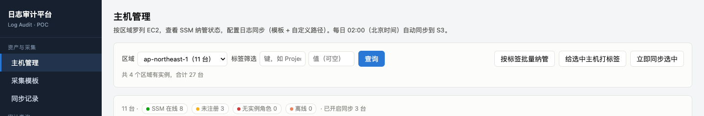

截图只保留筛选区与汇总徽标（账号内其他项目的主机不在文档中展示），主机列表见 9.1.2 按测试环境标签筛选后的视图。

<ul>
<li><b>区域与汇总</b>：区域下拉框下方的灰字汇总所有区域，截图中为"共 4 个区域有实例，合计 27 台"；当前 ap-northeast-1 区域有 11 台。</li>
<li><b>SSM 汇总徽标</b>：截图中为"11 台 · SSM 在线 8 · 未注册 3 · 无实例角色 0 · 离线 0 · 已开启同步 3 台"。绿色"SSM 在线"表示可以下发采集命令和实时查询；黄色"未注册 SSM"表示实例有实例角色，但没有注册到 SSM；红色"无实例角色"表示实例没有挂实例配置文件；橙色"离线"表示已注册但 Agent 当前不在线。</li>
<li><b>名称列</b>：主机名下面的小字最多列出 3 个标签（不含 Name 和 aws: 前缀的标签），如 la-web-01 下面是"Project=log-audit-poc OS=al2023"。</li>
<li><b>SSM 列</b>：在线主机下面会显示 SSM Agent 版本，如 la-web-01 是"agent 3.3.5700.0"，la-ubuntu-02 是"agent 3.3.4793.0"。</li>
<li><b>日志同步列</b>：已开启同步的主机显示蓝色"已开启"徽标，下面是套用的模板 ID，如 la-web-01 是"linux-security, web-nginx"，la-legacy-03 是"al2023-journal, web-nginx"，la-ubuntu-02 是"ubuntu-security, web-httpd"；有自定义路径时还会显示"+N 路径"。未开启的主机显示"未开启"。</li>
<li><b>最近同步列</b>：最近一次同步的时间（月-日 时:分）和入库行数，截图中三台测试主机都是 11-11 14:46，分别入库 370 / 195 / 259 行。</li>
<li><b>操作列</b>：每台主机都有"同步配置"（管理员可以编辑，普通用户显示为"查看配置"）；SSM 在线的主机多一个"实时查询"，点了会跳到主机日志查询页并带上这台主机；SSM 非在线的主机多一个"原因"（无实例角色时，管理员看到的是"接入"），见 9.1.4。</li>
<li><b>顶部按钮（仅管理员）</b>："按标签批量纳管"、"给选中主机打标签"（见 9.1.5）、"立即同步选中"。"立即同步选中"会马上对勾选的主机下发采集命令，日常靠每天 02:00（北京时间）的定时同步就够了，不要随手点。</li>
<li>主机较多时，列表在卡片里上下滚动查看。</li>
</ul>

<h4>9.1.2 按标签筛选主机</h4>

按 EC2 标签过滤主机列表，方便只看某个项目或环境的主机。

<ol>
<li>在"标签筛选"的第一个输入框填标签键（如 <code>Project</code>），第二个输入框填标签值（如 <code>log-audit-poc</code>）。值留空表示只要有这个键就匹配。</li>
<li>点"查询"，列表和汇总徽标都会按筛选结果重新统计。</li>
<li>要回到全部主机，清空两个输入框后再点一次"查询"。</li>
</ol>

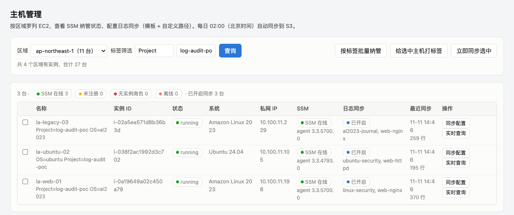

<ul>
<li>截图中按 Project=log-audit-poc 筛选后剩 3 台：la-legacy-03（i-02a5ea571d8b36b3d，Amazon Linux 2023）、la-ubuntu-02（i-038f2ac1992d3c702，Ubuntu 24.04）、la-web-01（i-0a19649a02c450a79，Amazon Linux 2023）。汇总徽标随之变成"3 台 · SSM 在线 3 · 已开启同步 3 台"。</li>
<li>这里填的标签键和值，会自动带到"按标签批量纳管"弹窗里作为默认值。</li>
</ul>

<h4>9.1.3 同步配置</h4>

为单台主机设置是否每天同步、套用哪些采集模板、追加哪些自定义路径，并预览最终会采集的路径。

<ol>
<li>在主机列表里找到目标主机（如 la-web-01），点这一行的"同步配置"。</li>
<li>勾选或取消"开启每日同步"。</li>
<li>在"采集模板"里勾选要套用的模板，可以多选。</li>
<li>如果还要采模板以外的日志，在"自定义路径"下点"+ 添加路径"，然后在新增的一行里依次填路径、选日志类型、选二进制处理方式；不需要的行点"删除"去掉。</li>
<li>在"生效路径预览"里核对最终会采集的路径。</li>
<li>确认后点右下角"保存"，配置下次同步时生效。只想查看的话，点右上角"关闭"即可，不会保存任何改动。</li>
</ol>

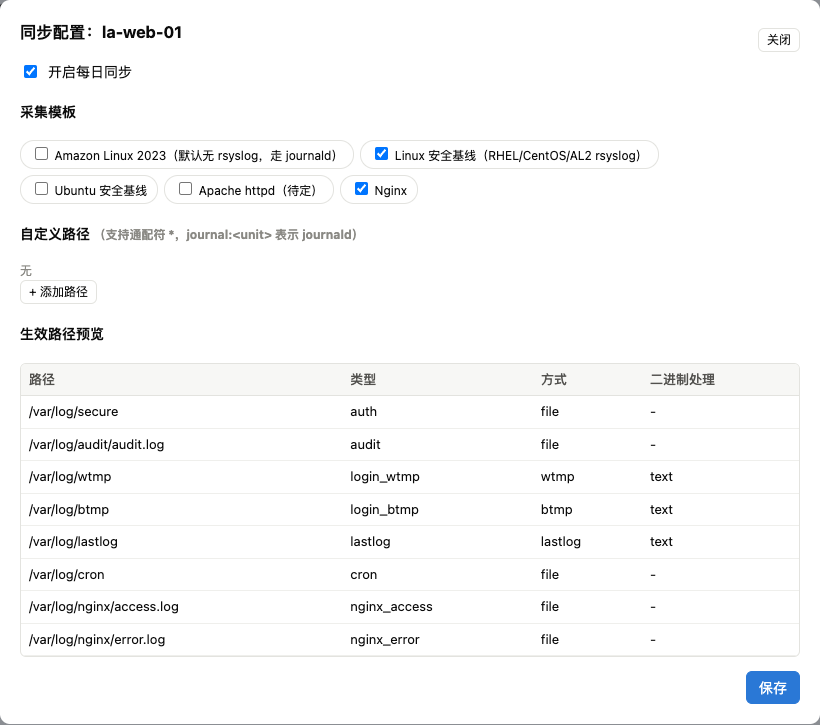

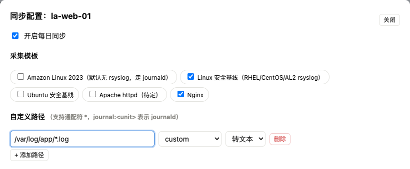

<ul>
<li><b>当前配置</b>：la-web-01 已开启每日同步，套用了"Linux 安全基线（RHEL/CentOS/AL2 rsyslog）"和"Nginx"两个模板，没有自定义路径（显示"无"）。</li>
<li><b>可选模板</b>：Amazon Linux 2023（默认无 rsyslog，走 journald）、Linux 安全基线（RHEL/CentOS/AL2 rsyslog）、Ubuntu 安全基线、Apache httpd（待定）、Nginx，内容见 9.1.6。</li>
<li><b>自定义路径</b>：路径支持通配符 <code>*</code>（如截图里示例填的 <code>/var/log/app/*.log</code>）；写成 <code>journal:&lt;unit&gt;</code> 表示从 journald 读取某个 unit 的日志。"日志类型"下拉框可选 auth、audit、cron、syslog、login_wtmp、login_btmp、lastlog、nginx_access、nginx_error、httpd_access、httpd_error、custom，新增行默认是 custom。"二进制处理"可选"转文本 / 原样 / 两者"，只对 wtmp、btmp、lastlog 这类二进制日志起作用。第二张图里的路径只是为了演示界面临时填的，没有保存。</li>
<li><b>生效路径预览</b>：列出所选模板路径和自定义路径合并后的结果，每条显示路径、类型、方式和二进制处理。截图中共 8 条：/var/log/secure、/var/log/audit/audit.log、/var/log/wtmp、/var/log/btmp、/var/log/lastlog、/var/log/cron、/var/log/nginx/access.log、/var/log/nginx/error.log。wtmp、btmp、lastlog 三条的二进制处理显示为 <code>text</code>（即"转文本"），普通文件显示"-"。注意：预览是按打开弹窗时已保存的配置计算的，在弹窗里勾选模板或添加路径不会立即刷新预览。</li>
<li>普通用户看到的是只读弹窗，没有"添加路径"和"保存"按钮。</li>
</ul>

<h4>9.1.4 SSM 未纳管原因</h4>

查看某台主机为什么没有被 SSM 纳管，以及如何处理。

<ol>
<li>在主机列表里找到 SSM 列不是"SSM 在线"的主机（截图中是脱敏后的示例主机 example-unmanaged-host，状态"未注册 SSM"），点这一行的"原因"。</li>
<li>阅读弹窗里的原因说明和"实例角色"。</li>
<li>如果主机上还没装 SSM Agent，展开"未装 SSM Agent 时的安装命令"，按系统选对应的命令，到主机上执行。</li>
<li>处理完后点"关闭"，回到列表点"查询"刷新状态。</li>
</ol>

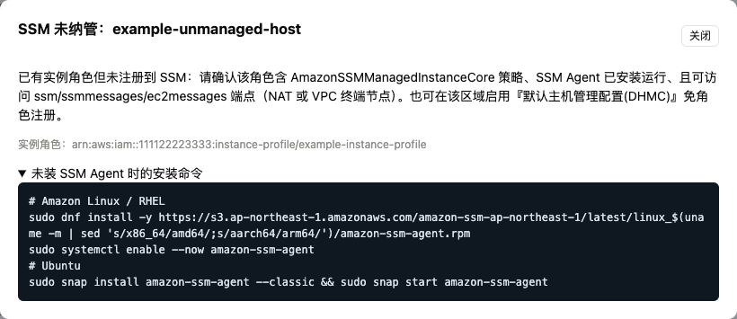

<ul>
<li><b>原因说明</b>：截图中这台主机属于"已有实例角色但未注册到 SSM"，平台给出的排查方向是：确认该角色带有 AmazonSSMManagedInstanceCore 策略；确认 SSM Agent 已安装并在运行；确认主机能访问 ssm、ssmmessages、ec2messages 三个端点（通过 NAT 或 VPC 终端节点）；也可以在该区域启用"默认主机管理配置（DHMC）"，免实例角色注册。</li>
<li><b>实例角色</b>：显示这台主机当前挂的实例配置文件 ARN，截图中是 example-unmanaged-host 的 example-instance-profile（ARN 中账号 ID 显示为示例值 111122223333）。这台主机的状态是 stopped（截图中的主机列表只展示测试环境主机，该主机行不在截图里），已停止的实例本身就无法注册 SSM。</li>
<li><b>安装命令</b>：分别给出 Amazon Linux / RHEL（dnf 安装当前区域的 rpm 包并 enable 服务）和 Ubuntu（snap 安装）的命令。</li>
<li>如果主机状态是"无实例角色"，管理员看到的按钮是"接入"，弹窗里会多一个"挂载 LogAuditInstanceProfile"按钮，点了会直接给这台实例挂上平台的实例角色。本次截图时区域内没有"无实例角色"的主机，所以没有展示这个按钮。</li>
</ul>

<h4>9.1.5 按标签批量纳管 / 给选中主机打标签</h4>

一次性为带某个标签的所有主机开启同步并套用模板；或者先给主机打上统一的标签，再按标签批量纳管。

<ol>
<li><b>按标签批量纳管</b>：在主机管理页点"按标签批量纳管"。弹窗里的标签键和值默认取自页面上的"标签筛选"（未填时键默认是 Project）。在"模板"里勾选要套用的模板，确认无误后点"执行"。</li>
<li><b>给选中主机打标签</b>：先在主机列表最左侧勾选一台或多台主机，再点"给选中主机打标签"。在弹窗里填标签键和值（默认是 LogAudit / enabled），确认后点"确定"。没勾选主机就点这个按钮，页面会提示"请先勾选主机"。</li>
<li>只想查看的话，点"关闭"即可，不会产生任何改动。</li>
</ol>

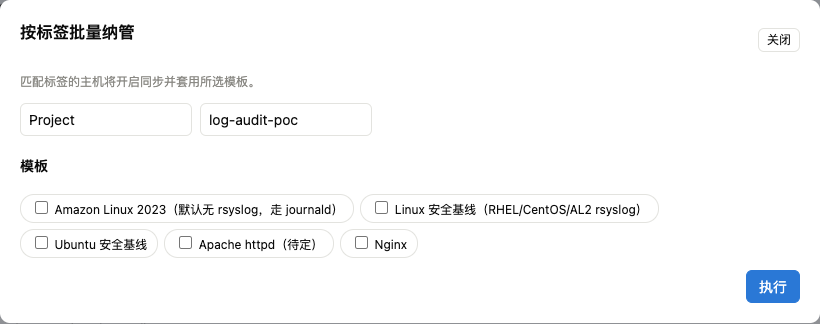

<ul>
<li><b>批量纳管</b>：弹窗说明写的是"匹配标签的主机将开启同步并套用所选模板"。截图中标签条件带入了 Project=log-audit-poc，按 9.1.2 的筛选结果会匹配 3 台测试主机。模板默认一个都不勾选，要自己选。点"执行"后会改写所有匹配主机的同步配置，执行完会提示"已纳管 N 台"。</li>
<li><b>打标签</b>：弹窗底部列出被选中的主机，截图中是"1 台：i-0a19649a02c450a79"（la-web-01）。点"确定"会直接在 EC2 实例上写入这个标签。</li>
<li>这两个功能只有管理员能看到。</li>
</ul>

<h4>9.1.6 采集模板</h4>

维护采集模板（一组日志路径）。主机套用某个模板，就会采集模板里的全部路径。

<ol>
<li>在左侧导航点"采集模板"，每个模板显示为一张卡片。</li>
<li>查看每张卡片里的路径、日志类型、采集方式和二进制处理方式。</li>
<li>要修改某个模板，点卡片右上角的"编辑"：在弹窗里改名称、增删路径，改完点"保存"。只想查看的话点"关闭"，不会保存。</li>
<li>要新增模板，点页面顶部的"新建模板"，填 ID（如 app-logs）、名称和路径后保存。</li>
<li>"删除"会先弹出确认框。已引用该模板的主机删除后就不再采集其中的路径，操作前请先确认没有主机在用这个模板。</li>
</ol>

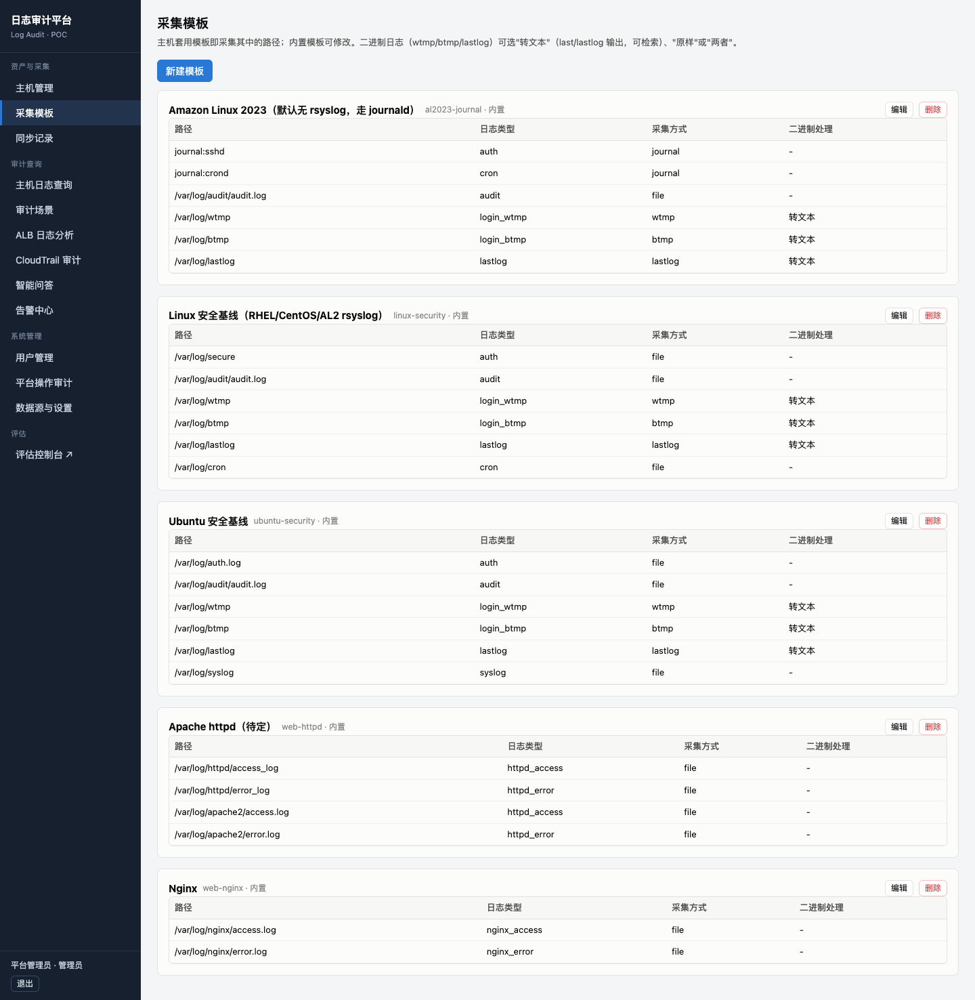

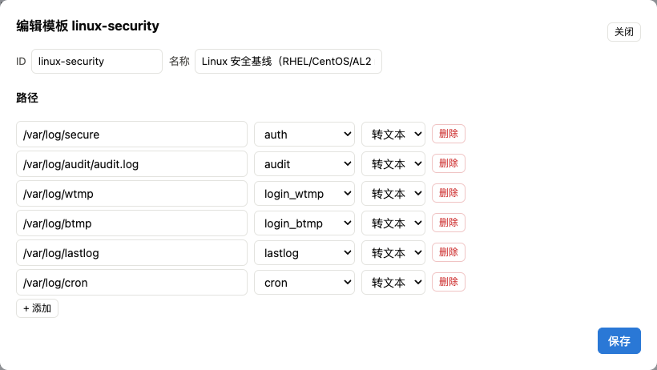

<ul>
<li><b>内置模板（共 5 个）</b>：
  <ul>
  <li>al2023-journal（Amazon Linux 2023，默认没有 rsyslog，走 journald）：journal:sshd、journal:crond，以及 audit.log、wtmp、btmp、lastlog。</li>
  <li>linux-security（Linux 安全基线，RHEL/CentOS/AL2 rsyslog）：/var/log/secure、audit.log、wtmp、btmp、lastlog、/var/log/cron。</li>
  <li>ubuntu-security（Ubuntu 安全基线）：/var/log/auth.log、audit.log、wtmp、btmp、lastlog、/var/log/syslog。</li>
  <li>web-httpd（Apache httpd，名称标注"待定"）：同时列出 /var/log/httpd/ 和 /var/log/apache2/ 两套 access 和 error 日志路径。</li>
  <li>web-nginx（Nginx）：/var/log/nginx/access.log、/var/log/nginx/error.log。</li>
  </ul>
  卡片标题右侧的灰字是模板 ID 和"内置"标记。内置模板也可以编辑。</li>
<li><b>采集方式</b>：file（文本文件，按偏移量增量读取）、journal（journald）、wtmp / btmp / lastlog（二进制登录记录）。</li>
<li><b>二进制处理</b>：只对 wtmp、btmp、lastlog 生效。截图中这三类都设为"转文本"，即转成 last / lastlog 命令的输出，转完可以检索；也可以选"原样"（保留原始二进制）或"两者"都要。</li>
<li><b>编辑弹窗</b>：截图中打开的是 linux-security。已有模板的 ID 不能修改，名称可以改；每行路径都有 路径 / 日志类型 / 二进制处理 三项和一个"删除"按钮，底部的"+ 添加"可以新增一行。弹窗里每行都会显示二进制处理下拉框，但普通文本文件不受这个选项影响，列表里也显示为"-"。</li>
</ul>

<h4>9.1.7 同步记录</h4>

按天查看每台主机每次同步的执行状态和入库结果，并追溯平台实际下发到主机上的命令。

<ol>
<li>在左侧导航点"同步记录"，默认显示当天的记录，按开始时间从新到旧排列。</li>
<li>要看其他日期，在"日期"里选一天，记录会自动刷新；也可以点"刷新"重新加载。</li>
<li>重点关注"状态"列和"入库"列里的缺失路径；如果某次同步失败，看"详情"列的报错信息。</li>
<li>要看某次同步具体执行了什么，点这一行的"执行的命令"（见 9.1.8）。</li>
</ol>

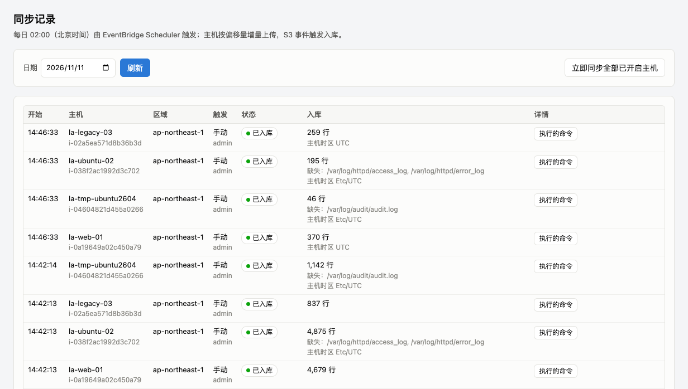

<ul>
<li><b>开始 / 主机 / 区域 / 触发</b>：开始时间精确到秒；主机名下面是实例 ID；"触发"显示"定时"或"手动"，下面是操作人。截图中 2026-11-11 的记录都是 admin 手动触发的，最近一批在 14:46:33 下发。</li>
<li><b>状态徽标</b>：已下发、已上传、已入库（绿色，整个流程完成）、主机执行失败、下发失败、跳过。截图中的记录都是"已入库"。当天更早的 09:55:03 那一批三台都是"主机执行失败"，详情是"failed to run commands: exit status 3"（在列表下方，需要往下滚动才能看到）。</li>
<li><b>入库列</b>：
  <ul>
  <li>本次入库行数：例如 14:46:33 这一批，la-web-01 入库 370 行、la-ubuntu-02 入库 195 行、la-legacy-03 入库 259 行。</li>
  <li>缺失：配置了但主机上不存在的路径。例如 la-ubuntu-02 缺失 /var/log/httpd/access_log 和 /var/log/httpd/error_log，因为它套用的 web-httpd 模板同时包含 httpd 和 apache2 两套路径，Ubuntu 上只有 apache2 那套。la-tmp-ubuntu2604 缺失 /var/log/audit/audit.log。</li>
  <li>主机时区：主机上报的时区，截图中为 UTC 或 Etc/UTC（时间较早的几条记录没有这一项）。</li>
  <li>日志轮转后补采了旧文件时，这一列还会多显示"轮转补采"。</li>
  </ul></li>
<li>截图中还出现了 la-tmp-ubuntu2604（i-04604821d455a0266）的记录，但这台主机不在当前的主机列表里。同步记录按批次保存，主机不在列表里了，它的历史记录仍会保留。</li>
<li>"立即同步全部已开启主机"（仅管理员）会马上对所有已开启同步的主机下发采集，不要随手点。</li>
</ul>

<h4>9.1.8 执行的命令</h4>

查看某次同步实际下发到主机的采集配置、主机返回的结果和完整脚本，用来审计和排查问题。

<ol>
<li>在同步记录列表中找到要查看的记录（截图中是 14:46:33 la-web-01 那一条），点"执行的命令"。</li>
<li>依次查看"采集配置"、"主机返回"和"下发的完整脚本"三部分。脚本区域较长，可以在框内上下滚动。</li>
<li>看完点"关闭"。</li>
</ol>

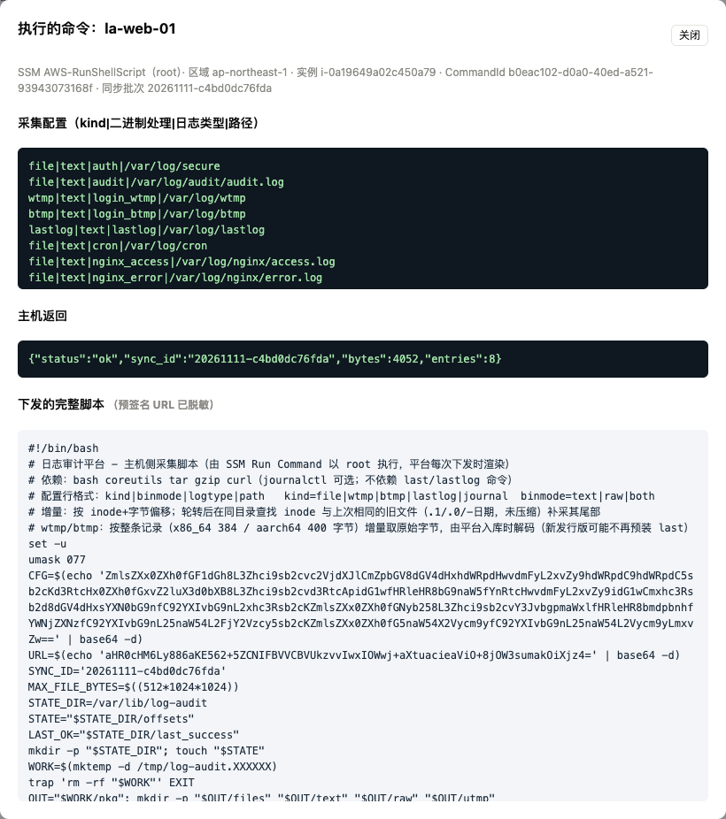

<ul>
<li><b>顶部说明</b>：执行方式是 SSM AWS-RunShellScript（以 root 身份运行），后面依次是区域 ap-northeast-1、实例 i-0a19649a02c450a79、SSM CommandId（b0eac102-d0a0-40ed-a521-93943073168f）和同步批次 ID（20261111-c4bd0dc76fda）。凭 CommandId 可以到 SSM 控制台或 CloudTrail 里对账。</li>
<li><b>采集配置</b>：每行格式是"kind|二进制处理|日志类型|路径"，例如 <code>file|text|auth|/var/log/secure</code>、<code>wtmp|text|login_wtmp|/var/log/wtmp</code>。截图中共 8 行，和 9.1.3 生效路径预览里的 8 条一一对应。</li>
<li><b>主机返回</b>：主机端脚本输出的 JSON，截图中是 <code>{"status":"ok","sync_id":"20261111-c4bd0dc76fda","bytes":4052,"entries":8}</code>，表示 8 个条目都处理了，共打包 4052 字节。主机有 stderr 输出时会追加在 [stderr] 段。</li>
<li><b>下发的完整脚本</b>：平台渲染后发给主机的 bash 脚本全文。脚本开头的注释说明了依赖（bash、coreutils、tar、gzip、curl，journalctl 可选）、按 inode 加字节偏移的增量采集方式、日志轮转后的补采逻辑，以及 wtmp/btmp 按整条记录增量读取。脚本中的采集配置和上传地址经过 base64 编码，其中预签名上传 URL 已被替换为"已隐藏"的占位文本，不会暴露真实链接。</li>
</ul>

<h3>9.2 主机日志查询</h3>
<h4>9.2.1 实时查询：浏览目录</h4>

平台通过 SSM 直接在主机上列出日志目录，用来确认主机上有哪些日志文件、各有多大、什么时候更新，不需要登录主机。

<ol>
<li>左侧导航进入“审计查询 → 主机日志查询”，停在默认的“实时查询（主机）”标签页。</li>
<li>区域保持 <code>ap-northeast-1</code>，“主机”下拉框选 <code>la-web-01 (i-0a19649a02c450a79)</code>。下拉框只列 SSM 在线的主机。</li>
<li>“目录”填 <code>/var/log/</code>（默认值），点击“浏览目录”。</li>
<li>等待几秒，左侧“文件”卡片会显示执行的命令和文件列表。列表可以滚动。</li>
</ol>

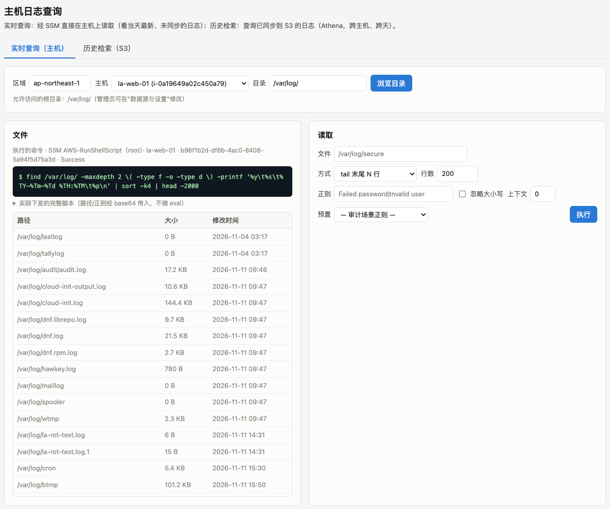

<ul>
<li>“执行的命令”区块列出本次下发的 SSM AWS-RunShellScript（root）、主机名、CommandId 和执行状态（Success），以及主机上实际运行的 <code>find /var/log/ -maxdepth 2 ...</code> 命令。展开“实际下发的完整脚本”可查看完整脚本：路径和正则经 base64 传入，不做 eval。</li>
<li>目录卡片下方提示允许访问的根目录（当前为 <code>/var/log/</code>）。这个范围由管理员在“数据源与设置”中维护，超出范围的路径会被拒绝。</li>
<li>文件列表按修改时间排序，例如 <code>/var/log/secure</code>（90.4 KB）、<code>/var/log/btmp</code>（101.2 KB）、<code>/var/log/wtmp</code>（2.3 KB），以及 0 B 的 <code>/var/log/lastlog</code>，还包括 <code>audit/</code>、<code>nginx/</code>、<code>chrony/</code> 等二级目录下的文件。</li>
<li>点击列表中的某个文件，会把路径填入右侧“读取”区的“文件”框。选中 wtmp/btmp 时“方式”自动切换为“last 解析”，选中 lastlog 时自动切换为“lastlog 快照”。</li>
</ul>

<h4>9.2.2 实时查询：grep 正则检索（SSH 暴力破解）</h4>

直接在主机上按正则检索当天最新、尚未同步到 S3 的日志，适合在发现安全事件后立即排查。

<ol>
<li>完成 9.2.1 的主机选择后，在右侧“读取”卡片的“文件”框中填 <code>/var/log/secure</code>（也可以在文件列表中点击该文件）。</li>
<li>“预置”下拉框选择“SSH 暴力破解”。系统会把正则自动填为 <code>Failed password|Invalid user|authentication failure</code>，并将“方式”切换为“grep 正则检索”。</li>
<li>“行数”保持 200，“上下文”保持 0，点击“执行”。</li>
<li>结果显示在页面下方的“输出”卡片中。</li>
</ol>

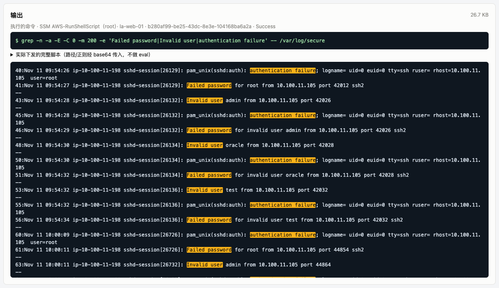

<ul>
<li>主机上实际执行的命令为 <code>grep -n -a -E -C 0 -m 200 -e 'Failed password|Invalid user|authentication failure' -- /var/log/secure</code>。<code>-m 200</code> 表示最多返回 200 条匹配，对应“行数”设置。右上角显示本次返回的数据量（26.7 KB）。</li>
<li>每行前面的数字是该行在原文件中的行号，命中的关键词以黄色高亮显示。</li>
<li>从输出可以看到，来源 IP <code>10.100.11.105</code> 从 09:54 起反复尝试 <code>root</code>、<code>admin</code>、<code>oracle</code>、<code>test</code> 等账号，每次都伴随 <code>Invalid user</code>、<code>Failed password</code> 和 <code>authentication failure</code>，是典型的口令暴力破解特征。</li>
</ul>

<h4>9.2.3 实时查询：解析二进制登录日志（btmp）</h4>

btmp/wtmp 是二进制格式，不能直接 grep。平台在主机上调用 <code>last</code> 将其转成可读文本，用于查看失败登录记录（btmp）或登录/注销历史（wtmp）。

<ol>
<li>在“读取”卡片的“文件”框中填 <code>/var/log/btmp</code>（也可以在文件列表中点击该文件）。</li>
<li>“方式”选择“last 解析 wtmp/btmp”。此方式不使用正则，“正则”框里的内容不影响结果。</li>
<li>点击“执行”，在“输出”卡片查看结果。</li>
</ol>

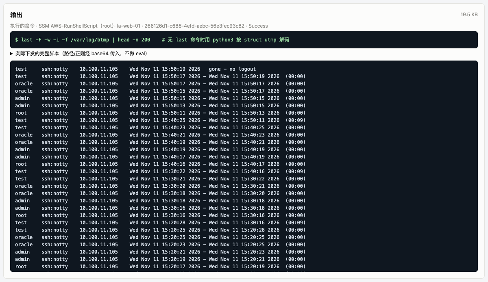

<ul>
<li>执行的命令为 <code>last -F -w -i -f /var/log/btmp | head -n 200</code>。主机上没有 <code>last</code> 命令时，平台会改用 python3 按 struct utmp 解码，结果格式相同。</li>
<li>每行依次为尝试登录的用户名、终端（<code>ssh:notty</code>）、来源 IP 和完整时间。截图中全部失败登录都来自 <code>10.100.11.105</code>，尝试的账号依次为 <code>root</code>、<code>admin</code>、<code>oracle</code>、<code>test</code>，大约每 10 分钟一轮（15:50、15:40、15:30、15:20…，输出按时间倒序）。这与 9.2.2 中 secure 日志的结论一致。</li>
</ul>

<h4>9.2.4 实时查询：lastlog 快照</h4>

lastlog 记录每个系统账号最近一次登录的时间和来源，用于核对哪些账号曾被登录。

<ol>
<li>在“读取”卡片的“文件”框中填 <code>/var/log/lastlog</code>（也可以在文件列表中点击该文件）。</li>
<li>“方式”选择“lastlog 快照”，点击“执行”。</li>
</ol>

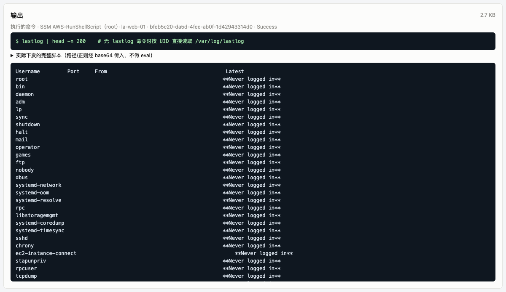

<ul>
<li>执行的命令为 <code>lastlog | head -n 200</code>。主机上没有 <code>lastlog</code> 命令时（例如 AL2023），平台按 UID 直接读取 <code>/var/log/lastlog</code>。</li>
<li>输出包含 Username、Port、From、Latest 四列。la-web-01 的 <code>/var/log/lastlog</code> 文件大小为 0 B（见 9.2.1 的文件列表），所以截图中全部账号显示 <code>**Never logged in**</code>，表示没有账号成功登录过。</li>
</ul>

<h4>9.2.5 历史检索（S3）：auth 日志关键字检索</h4>

通过 Athena 查询已同步到 S3 的主机日志，可以跨主机、跨天统一检索。

<ol>
<li>在“主机日志查询”页面切换到“历史检索（S3）”标签页。</li>
<li>开始和结束日期保持默认（最近 7 天，截图中为 2026/11/04 ~ 2026/11/11）。“主机”不选，即查询全部主机；需要多选时按住 ⌘/Ctrl。</li>
<li>“日志类型”选择 <code>auth</code>，“关键字”填 <code>Failed password</code>，“正则”不勾选，“条数”保持 500。</li>
<li>点击“检索”，等待结果表出现。Athena 查询一般需要几秒。</li>
</ol>

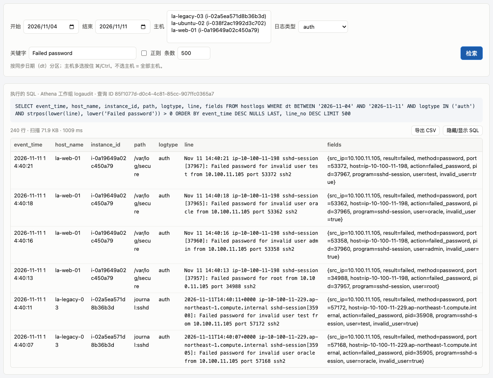

<ul>
<li>“执行的 SQL”区块列出 Athena 工作组（logaudit）、查询 ID 和完整 SQL。分区条件是 <code>dt BETWEEN '2026-11-04' AND '2026-11-11'</code>，类型条件是 <code>logtype IN ('auth')</code>，关键字匹配用 <code>strpos(lower(line), lower('Failed password')) &gt; 0</code>，因此不区分大小写。点击“隐藏/显示 SQL”可以折叠这个区块，点击“导出 CSV”可以下载结果。</li>
<li>本次返回 240 行，扫描 71.9 KB，耗时 1009 ms。命中的主机是 <code>la-web-01</code>（来源文件 <code>/var/log/secure</code>）和 <code>la-legacy-03</code>（来源 <code>journal:sshd</code>）。两种来源统一归为 auth 类型，可以在同一次检索中查询。</li>
<li><code>fields</code> 列是入库时解析出的结构化字段，例如 <code>src_ip=10.100.11.105</code>、<code>action=failed_password</code>、<code>user=test</code>、<code>invalid_user=true</code>、<code>port</code>、<code>pid</code>。后续统计可以直接引用这些字段，不必再写正则。</li>
</ul>

<h4>9.2.6 历史检索（S3）：login_btmp 失败登录记录</h4>

同步时，btmp 二进制日志会被转成文本入库，因此可以像普通日志一样跨主机检索失败登录记录。

<ol>
<li>在“历史检索（S3）”标签页，日期保持默认。</li>
<li>“日志类型”选择 <code>login_btmp</code>，“关键字”留空，即返回该类型的全部记录。</li>
<li>点击“检索”。</li>
</ol>

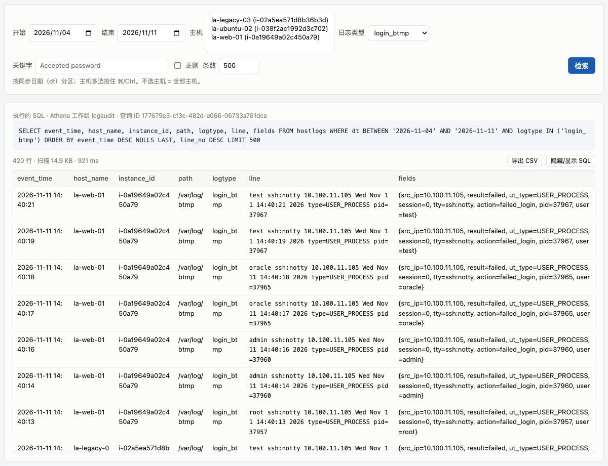

<ul>
<li>关键字为空时，SQL 中只有日期分区条件和 <code>logtype IN ('login_btmp')</code> 条件，结果按 <code>event_time</code> 倒序排列。本次返回 420 行，扫描 14.9 KB。</li>
<li><code>line</code> 列是 btmp 转成的文本（用户、终端、来源 IP、时间、<code>type=USER_PROCESS</code>、pid）。<code>fields</code> 列解析出 <code>src_ip=10.100.11.105</code>、<code>result=failed</code>、<code>action=failed_login</code>、<code>user=test/oracle/admin/root</code> 等字段。命中的主机包括 <code>la-web-01</code>（<code>/var/log/btmp</code>）和 <code>la-legacy-03</code>。</li>
</ul>

<h4>9.2.7 审计场景：场景总览</h4>

审计场景把常见的主机安全审计需求预置成可以一键执行的 Athena 分析，查询对象是已同步到 S3 的主机日志。

<ol>
<li>左侧导航进入“审计查询 → 审计场景”。</li>
<li>在顶部筛选卡片中设置开始和结束日期（默认最近 7 天）以及主机（不选即全部主机）。</li>
<li>浏览下方的场景卡片，根据需要调整阈值后点击“执行”。</li>
</ol>

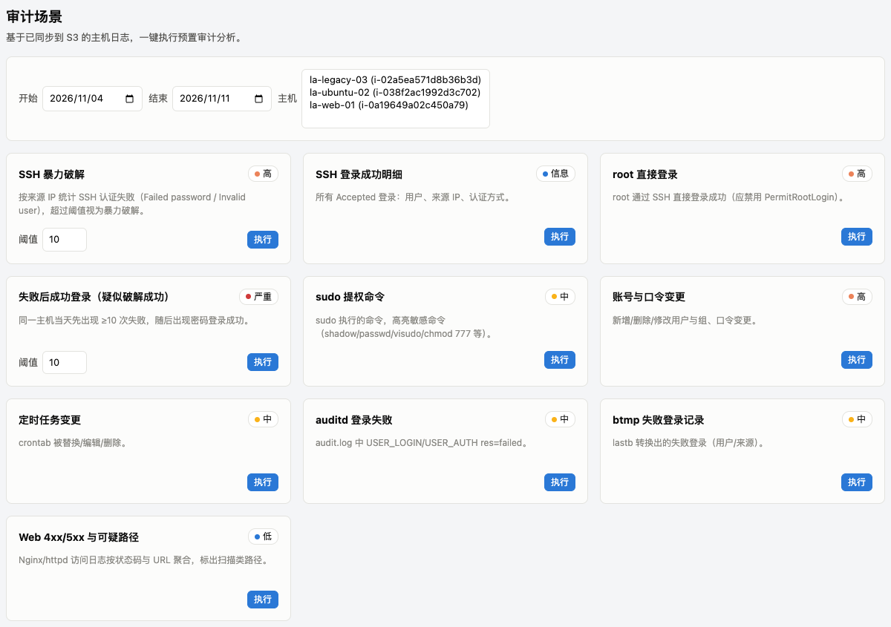

<ul>
<li>平台预置了 10 个场景：SSH 暴力破解（高）、SSH 登录成功明细（信息）、root 直接登录（高）、失败后成功登录（疑似破解成功，严重）、sudo 提权命令（中）、账号与口令变更（高）、定时任务变更（中）、auditd 登录失败（中）、btmp 失败登录记录（中）、Web 4xx/5xx 与可疑路径（低）。</li>
<li>每张卡片右上角标注风险等级，并用一句话说明判定逻辑。“SSH 暴力破解”和“失败后成功登录”两张卡片带有可修改的“阈值”（默认 10 次）。</li>
</ul>

<h4>9.2.8 审计场景：SSH 暴力破解</h4>

按主机和来源 IP 统计 SSH 认证失败次数，次数超过阈值即判定为暴力破解，同时列出尝试过的账号。

<ol>
<li>在“审计场景”页面保持默认日期和主机范围。</li>
<li>在“SSH 暴力破解”卡片上确认阈值（默认 10），点击“执行”。</li>
<li>页面会自动滚动到下方结果卡片，等待结果表出现。</li>
</ol>

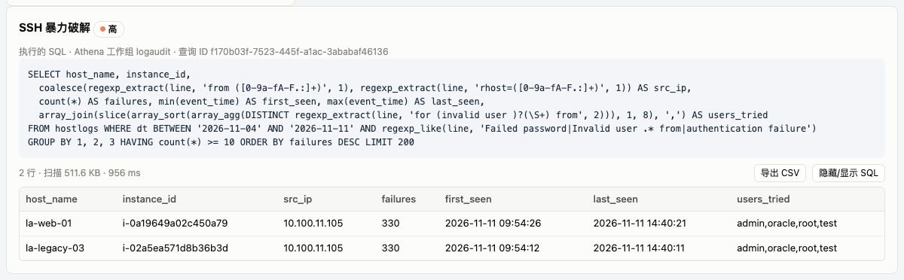

<ul>
<li>SQL 用 <code>regexp_extract</code> 从 <code>from &lt;IP&gt;</code> 或 <code>rhost=&lt;IP&gt;</code> 中提取来源 IP，按主机、实例和来源 IP 分组，用 <code>HAVING count(*) &gt;= 10</code> 实现阈值判断，并用 <code>array_agg(DISTINCT ...)</code> 汇总尝试过的账号。</li>
<li>本次返回 2 行。<code>la-legacy-03</code> 和 <code>la-web-01</code> 都被来源 IP <code>10.100.11.105</code> 暴力破解，各失败 330 次。时间范围分别为 2026-11-11 09:54:12~14:40:11 和 09:54:26~14:40:21，尝试的账号都是 <code>admin,oracle,root,test</code>。</li>
</ul>

<h4>9.2.9 审计场景：账号与口令变更</h4>

汇总主机上新增、删除、修改用户和组，以及修改口令的记录，同时覆盖 auth 和 auditd 两类日志。

<ol>
<li>在“审计场景”页面保持默认日期和主机范围。</li>
<li>在“账号与口令变更”卡片上点击“执行”。</li>
</ol>

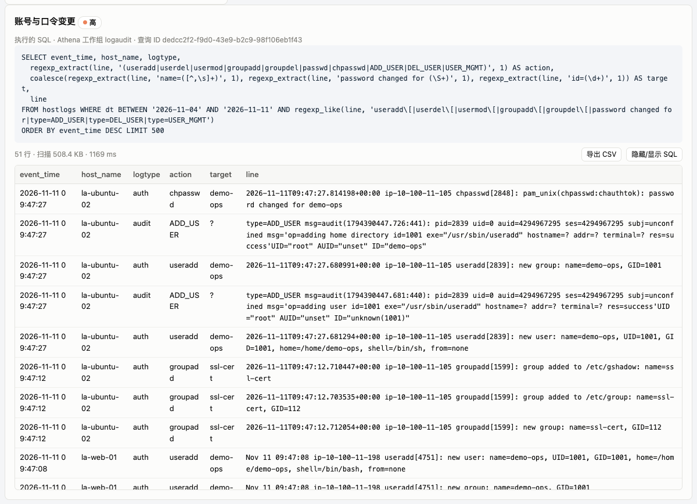

<ul>
<li>SQL 同时匹配 <code>useradd[</code>、<code>userdel[</code>、<code>groupadd[</code>、<code>password changed for</code> 等 auth 日志关键字，以及 <code>type=ADD_USER</code>、<code>type=DEL_USER</code>、<code>type=USER_MGMT</code> 等 auditd 事件。<code>action</code> 列提取动作类型，<code>target</code> 列提取操作对象。</li>
<li>本次返回 51 行。可以看到 2026-11-11 09:47:27，<code>la-ubuntu-02</code> 上的 useradd 新建了用户和组 <code>demo-ops</code>（UID/GID 1001），随后 chpasswd 修改了它的口令（<code>password changed for demo-ops</code>）。auditd 同时记录了对应的 <code>ADD_USER</code> 事件，<code>target</code> 显示为 <code>?</code>，账号名在 line 中的 <code>ID="demo-ops"</code>。09:47:08，<code>la-web-01</code> 上也新建了 <code>demo-ops</code> 用户。另有 <code>la-ubuntu-02</code> 上的 <code>ssl-cert</code> 组新增记录。</li>
</ul>

<h3>9.3 ALB 与 CloudTrail</h3>
<h4>9.3.1 ALB 分析看板：查询条件</h4>

先选数据源和日期范围，后面的看板、条件检索都按这里的条件查询。

<ol>
<li>左侧导航进入"ALB 日志分析"（地址 <code>#alb</code>），默认打开"分析看板"tab。</li>
<li>"数据源"下拉选"合成演示数据（shop-web/shop-api）"，括号里是它对应的 S3 桶/前缀。</li>
<li>"开始"填 2026/11/01，"结束"填 2026/11/03；"负载均衡器"不填，表示分析全部 ALB。</li>
<li>点"分析"。</li>
</ol>

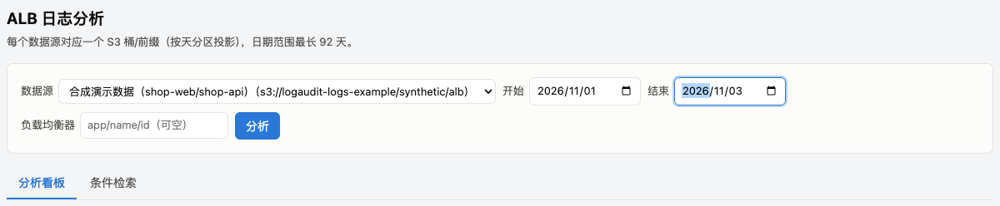

<ul>
<li>页面提示日期范围最长 92 天，S3 日志按天做分区投影，所以只扫描所选日期的数据。</li>
<li>点"分析"后 12 个报表并行提交到 Athena，结果陆续出现（本例多数报表约 0.7~1.6 秒（个别因 Athena 排队较慢：慢请求 15,966 ms、User-Agent 12,864 ms），各扫描 909.8 KB）。</li>
</ul>

<h4>9.3.2 ALB 分析看板：总览与趋势</h4>

先看整体流量、错误率和延迟，从趋势图里找异常时段。

<ol>
<li>按 9.3.1 的条件点"分析"后，看页面顶部的 KPI 卡片和下面两张图。</li>
<li>选的范围不超过 2 天时按小时聚合，超过 2 天按天聚合。</li>
</ol>

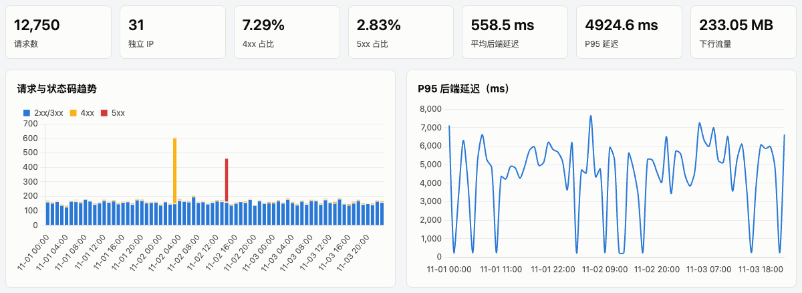

<ul>
<li>KPI：请求数 12,750、独立 IP 31、4xx 占比 7.29%、5xx 占比 2.83%、平均后端延迟 558.5 ms、P95 延迟 4924.6 ms、下行流量 233.05 MB。</li>
<li>"请求与状态码趋势"按 2xx/3xx、4xx、5xx 堆叠：11-02 凌晨有一根约 600 的 4xx 尖峰（对应 9.3.4 的扫描 IP），11-02 14:00 有一根约 460 的 5xx 尖峰（对应 9.3.6 的 5xx 爆发）。</li>
<li>"P95 后端延迟"多数时段在 4,000~7,600 ms，主要是慢接口 /api/v1/report/export 拉高的。</li>
</ul>

<h4>9.3.3 ALB 分析看板：地理分布与状态码</h4>

看流量来自哪些国家，以及 ELB 和后端状态码的组合。

<ol>
<li>在同一看板往下滚动到"地理分布（Top 500 IP 归属国家）"和"状态码分布"。</li>
<li>每个表格上方默认展示执行的 SQL，点"隐藏/显示 SQL"可以收起；点"导出 CSV"可以下载结果。</li>
</ol>

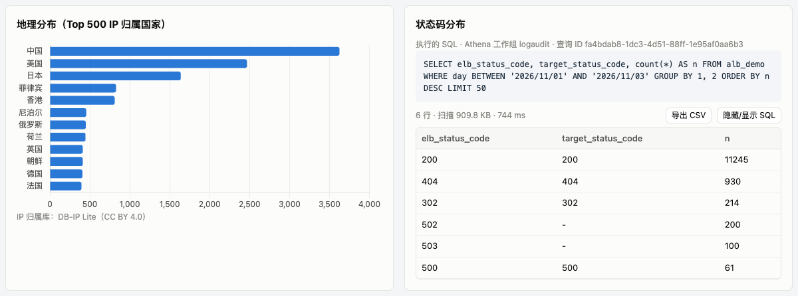

<ul>
<li>地理分布：中国（约 3,600）、美国、日本居前，其后是菲律宾、香港、尼泊尔、俄罗斯等，IP 归属库为 DB-IP Lite（CC BY 4.0）。</li>
<li>状态码分布同时列出 elb_status_code 和 target_status_code：200 有 11,245 条，404 有 930 条；502 有 200 条、503 有 100 条，它们的 target_status_code 都是"-"，说明请求没有到达后端，是 ALB 自己返回的；500 有 61 条，是后端返回的。</li>
</ul>

<h4>9.3.4 ALB 分析看板：疑似扫描 / 攻击来源</h4>

自动找出访问敏感路径，或者 404 占比过高的客户端 IP。

<ol>
<li>在看板中找到"疑似扫描 / 攻击来源"卡片。</li>
<li>展开的 SQL 里写着判定规则：URL 命中 .env、wp-login、phpmyadmin、.git/、actuator、cgi-bin、/etc/passwd、union select、&lt;script&gt; 等特征，或者请求数 ≥ 50 且 404 占比超过 50%。</li>
</ol>

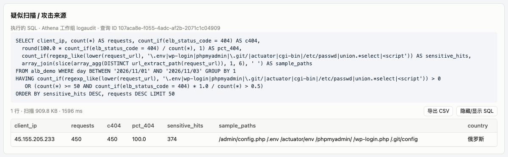

<ul>
<li>命中 1 个 IP：45.155.205.233（俄罗斯），共 450 次请求，全部是 404（pct_404 = 100.0），其中 374 次访问敏感路径。</li>
<li>sample_paths 列出它探测过的路径样例：/admin/config.php、/.env、/actuator/env、/phpmyadmin/、/wp-login.php、/.git/config（array_agg DISTINCT 取前 6 个，每次顺序和内容可能不同）。</li>
</ul>

<h4>9.3.5 ALB 分析看板：Top 客户端 IP 与 Top URL</h4>

按请求量排出访问最多的客户端和接口，看每个 IP 的错误数和活跃时段、每个接口的 5xx 数和平均耗时。

<ol>
<li>在看板中找到"Top 客户端 IP"和"Top URL"两张并排的表，表格过长时可以在框内滚动。</li>
</ol>

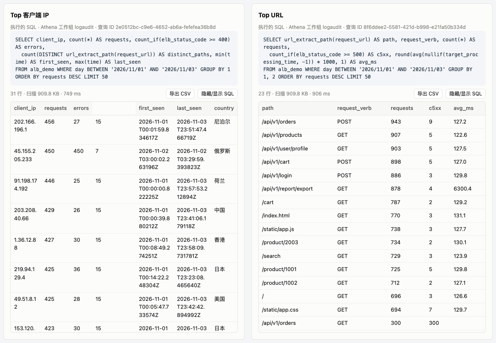

<ul>
<li>Top 客户端 IP 共 31 行，每行带 errors、distinct_paths、first_seen/last_seen 和 country。扫描 IP 45.155.205.233 排第 2：450 次请求、450 次错误，只访问了 7 个路径，而且只在 2026-11-02 03:00~03:29 出现，和其他 IP 全天均匀访问明显不同。</li>
<li>Top URL 共 23 行：/api/v1/orders（POST）943 次居首；/api/v1/report/export 878 次，avg_ms 达 6300.4，是其他接口（约 120~130 ms）的约 50 倍；另有一行 /api/v1/orders（GET）300 次、c5xx 也是 300，没有后端耗时，对应 14:00 的 502/503 爆发。</li>
</ul>

<h4>9.3.6 ALB 分析看板：5xx 明细与慢请求</h4>

把 5xx 按小时、负载均衡器、后端目标拆开定位，同时列出超过耗时阈值的接口。

<ol>
<li>在看板中找到"5xx 明细"和"慢请求"两张表。</li>
<li>慢请求阈值默认 1 秒，可以在标题里的输入框修改，改完后重新点"分析"生效。</li>
</ol>

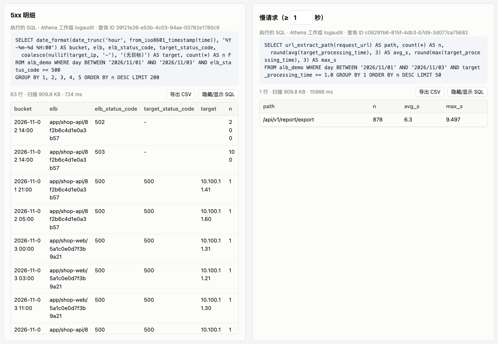

<ul>
<li>5xx 明细共 63 行，排在最前的两行都是 2026-11-02 14:00、app/shop-api/8f2b6c4d1e0a3b57：502 有 200 条、503 有 100 条，target 是"(无目标)"，说明这一小时后端目标不可用。其余是 shop-web 零散的 500，每行 1 条，能定位到具体后端 IP（如 10.100.11.32）。</li>
<li>慢请求（≥ 1 秒）只有 1 个接口：/api/v1/report/export，878 次，平均 6.3 秒，最长 9.497 秒。</li>
</ul>

<h4>9.3.7 ALB 分析看板：各负载均衡器与 User-Agent</h4>

对比各 ALB 的流量和错误，看客户端类型构成。

<ol>
<li>在看板中找到"各负载均衡器"和"User-Agent"两张表。</li>
</ol>

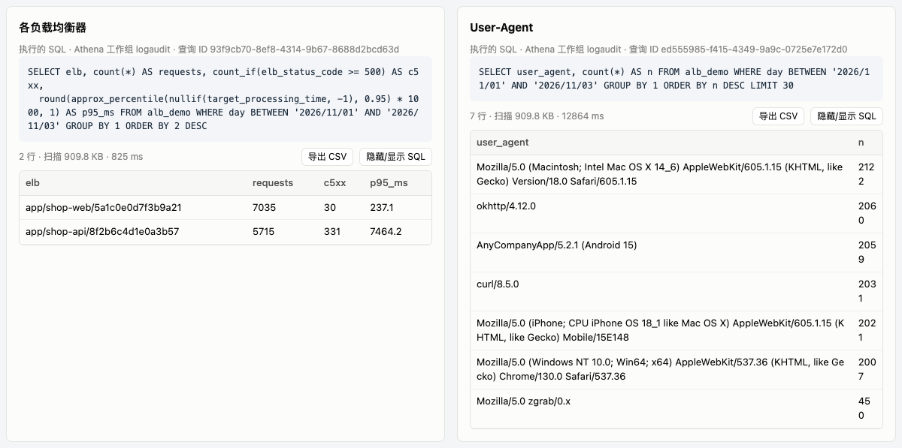

<ul>
<li>app/shop-web 有 7,035 次请求、30 次 5xx、P95 237.1 ms；app/shop-api 有 5,715 次请求、331 次 5xx、P95 7,464.2 ms。问题集中在 shop-api。</li>
<li>User-Agent 共 7 种，正常客户端（Safari、okhttp、AnyCompanyApp、curl、iPhone、Chrome）各约 2,000 次；"Mozilla/5.0 zgrab/0.x" 450 次，和扫描 IP 的请求数一致，是扫描器特征。</li>
</ul>

<h4>9.3.8 日志格式与解析率</h4>

ALB 日志格式会随时间追加字段，平台用一张表兼容新旧格式。这个报表按"最后一个非空字段"判断每条日志属于哪一版格式，出现"解析失败"说明有未知格式。

<ol>
<li>"数据源"切换为 legacy_mix（各代格式样本），"开始"和"结束"都填 2019/03/01，点"分析"。</li>
<li>滚动到看板底部的"日志格式与解析率"卡片。</li>
</ol>

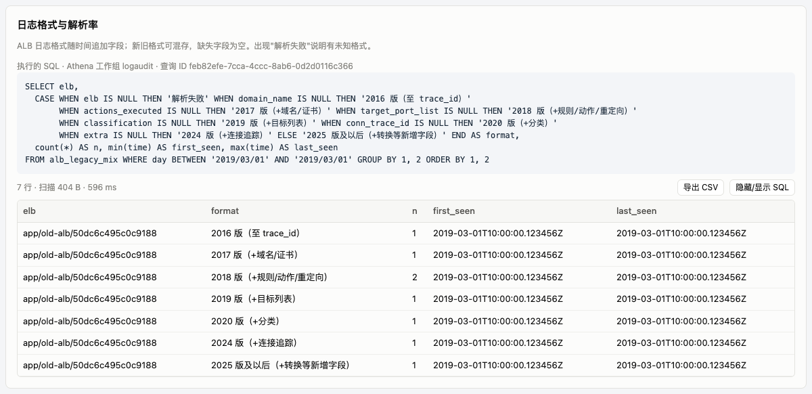

<ul>
<li>样本共 8 条日志，全部识别成功，没有"解析失败"：2016 版（至 trace_id）、2017 版（+域名/证书）、2018 版（+规则/动作/重定向）2 条、2019 版（+目标列表）、2020 版（+分类）、2024 版（+连接追踪）、2025 版及以后（+转换等新增字段）各 1 条，结果共 7 行。</li>
<li>SQL 里用 CASE WHEN 依次判断 domain_name、actions_executed、target_port_list、classification、conn_trace_id、extra 是否为空来区分版本，一共可以区分 7 个格式档位。2018 版有 2 条样本，所以 8 条样本只得到 7 行结果。</li>
<li>对照：demo 数据源同样位置显示 shop-api 5,715 条、shop-web 7,035 条，全部是"2025 版及以后"（见下图）。</li>
</ul>

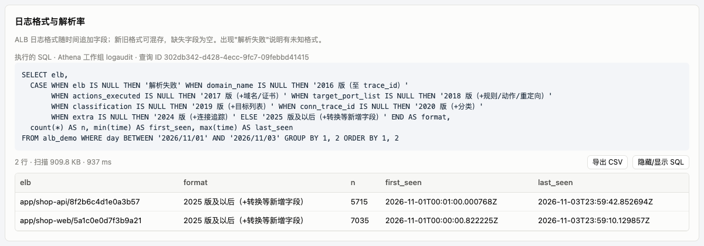

<h4>9.3.9 ALB 条件检索</h4>

按 IP、状态码、URL、方法、延迟等条件查原始日志明细，用于定位具体请求。

<ol>
<li>在 ALB 日志分析页点"条件检索"tab。</li>
<li>"数据源"选合成演示数据，"开始"和"结束"都填 2026/11/02。</li>
<li>"状态码"填 <code>5xx</code>（也可以填具体值，如 404），其他条件留空，"条数"保持 200。</li>
<li>点右侧"检索"。</li>
</ol>

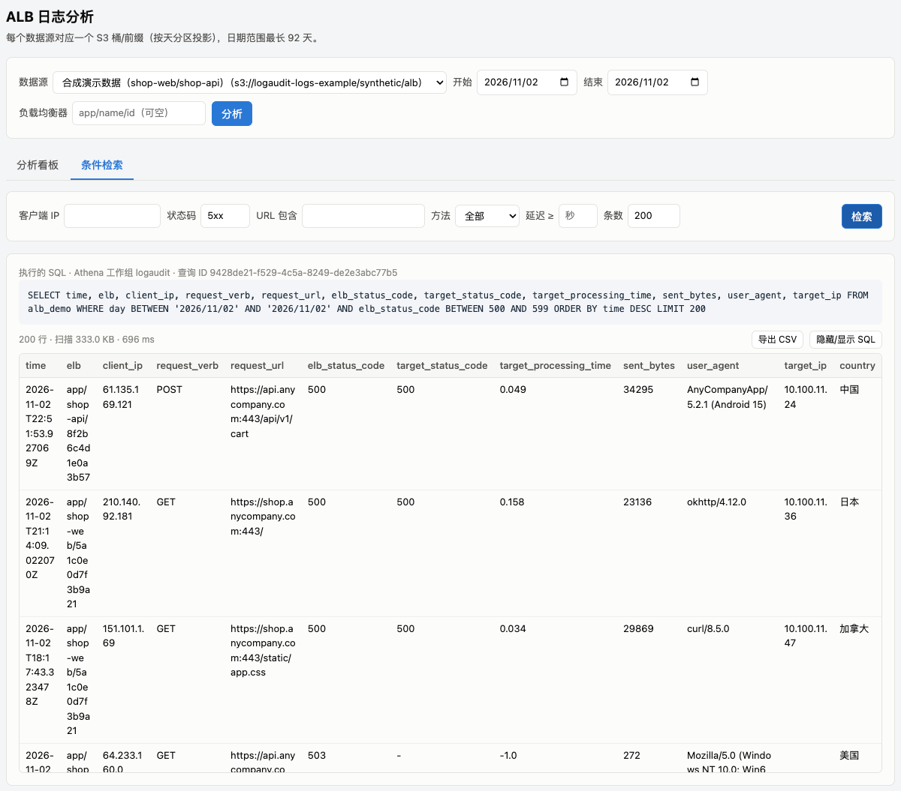

<ul>
<li>执行的 SQL 把"5xx"转换成 <code>elb_status_code BETWEEN 500 AND 599</code>，只扫描 day = 2026/11/02 的分区（333.0 KB，696 ms），返回 200 行（达到条数上限）。</li>
<li>返回列有 time、elb、client_ip、request_verb、request_url、elb_status_code、target_status_code、target_processing_time、sent_bytes、user_agent、target_ip。最后的 country 列不在 SQL 里，是平台按 client_ip 补上的归属国家（如中国、日本、加拿大、美国）。</li>
<li>503 那一行 target_status_code 是"-"、target_processing_time 是 -1.0、target_ip 为空，说明请求没有转发到后端。</li>
</ul>

<h4>9.3.10 CloudTrail 审计：查询条件与预置查询</h4>

在 Athena 上查 CloudTrail 日志，用预置查询快速回答常见的审计问题。

<ol>
<li>左侧导航进入"CloudTrail 审计"（地址 <code>#cloudtrail</code>）。</li>
<li>页面顶部显示当前数据源 S3 路径，并提示全局服务事件（如 IAM、控制台登录）记录在 us-east-1。</li>
<li>条件区：开始/结束日期（默认最近 3 天）、区域（逗号分隔，默认 us-east-1,ap-northeast-1）、操作者包含、事件名、源 IP。</li>
<li>下面一排是预置查询：控制台登录（含失败）、root 账号活动、IAM 变更、安全组/网络 ACL 变更、删除/终止类操作、权限拒绝（AccessDenied）、SSM 会话/远程命令、调用方 Top（按 API 量）；"按条件检索"按上面填写的条件自由查询。</li>
</ol>

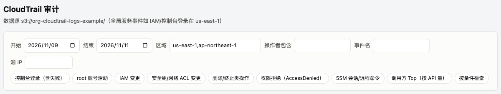

<ul>
<li>预置查询也会使用上面的日期和区域条件，点按钮就直接执行。</li>
</ul>

<h4>9.3.11 CloudTrail 审计：SSM 会话/远程命令</h4>

查谁通过 SSM 在实例上开过会话或执行过远程命令。

<ol>
<li>"开始""结束"都填今天（2026/11/11），"区域"改为 <code>ap-northeast-1</code>。</li>
<li>点预置查询"SSM 会话/远程命令"，等十几秒出结果。</li>
</ol>

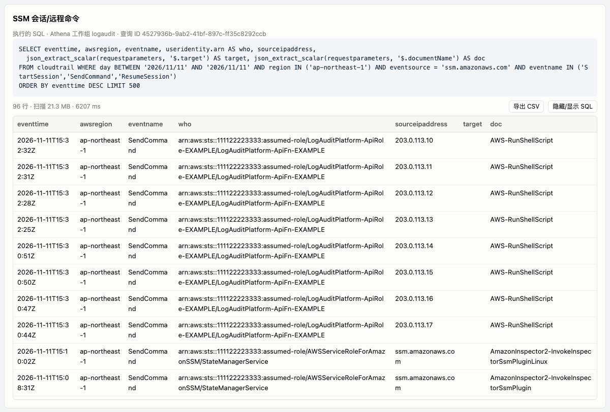

<ul>
<li>SQL 筛选 eventsource = 'ssm.amazonaws.com' 且 eventname 为 StartSession、SendCommand 或 ResumeSession，返回 96 行（扫描 21.3 MB，6,207 ms）。</li>
<li>大部分记录是 LogAuditPlatform-ApiRole-EXAMPLE 执行的 SendCommand、文档 AWS-RunShellScript，源 IP 为平台后端主机的公网地址（截图中已替换为 203.0.113.x 示例段），即平台后端 API 角色通过 SSM 在主机上执行命令（如实时日志查询）留下的记录。还有 AWSServiceRoleForAmazonSSM/StateManagerService 以 ssm.amazonaws.com 身份执行的 AmazonInspector2-InvokeInspectorSsmPlugin 文档（Inspector 扫描）。另外还有管理员通过 SSM 手工执行命令的记录（who 为 …/admin/operator，不在截图可见的前 10 行内）。</li>
<li>who 列是完整的 assumed-role ARN，可以追溯到具体角色和会话。</li>
</ul>

<h4>9.3.12 CloudTrail 审计：控制台登录（含失败）</h4>

审计控制台登录记录，包括登录结果和是否使用 MFA。

<ol>
<li>"区域"改为 <code>us-east-1</code>（控制台登录是全局事件，记录在 us-east-1），日期保持今天。</li>
<li>点预置查询"控制台登录（含失败）"。</li>
</ol>

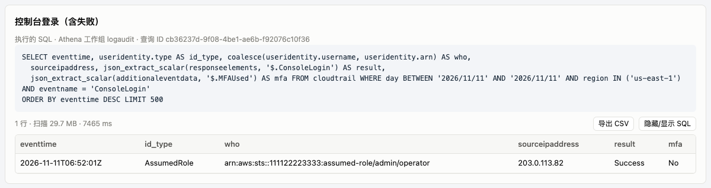

<ul>
<li>SQL 筛选 eventname = 'ConsoleLogin'，从 responseelements 中取登录结果，从 additionaleventdata 中取 MFAUsed。</li>
<li>当天 1 条记录：2026-11-11T06:52:01Z，身份类型 AssumedRole（arn:aws:sts::111122223333:assumed-role/admin/operator），源 IP 203.0.113.82（脱敏示例值），result = Success，mfa = No。如果有失败登录，result 会显示 Failure。</li>
</ul>

<h3>9.4 智能问答与告警</h3>
<h4>9.4.1 智能问答：入口与示例问题</h4>

用自然语言提问，助手把问题转成只读 SQL 在 Athena 上执行，再解释结果；不需要会写 SQL。

<ol>
<li>登录平台后，在左侧导航「审计查询」分组下点击「智能问答」。</li>
<li>页面上方是对话区（未提问时显示“还没有对话”），下方是示例问题和输入框。</li>
<li>点击任一示例问题，它会填入输入框，可以直接发送，也可以先改写；也可以在输入框里自己写问题。</li>
</ol>

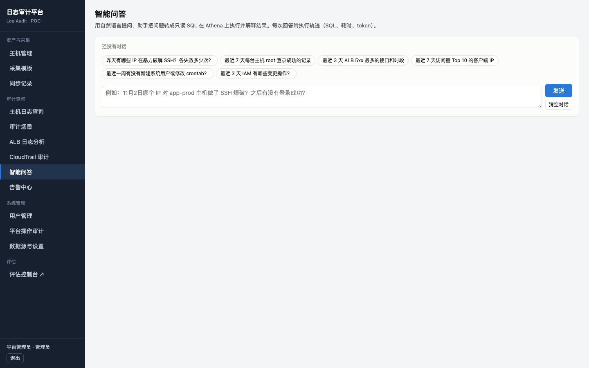

<ul>
<li>内置 6 个示例问题，覆盖主机认证（SSH 暴力破解、root 登录、新建用户 / crontab）、ALB（5xx 接口与时段、访问量 Top 10 IP）和 CloudTrail（IAM 变更）。</li>
<li>右侧「发送」提交问题，快捷键 Ctrl/⌘ + Enter；「清空对话」清掉当前的多轮上下文。</li>
<li>页面说明写明“每次回答附执行轨迹（SQL、耗时、token）”，结果可以核查。</li>
</ul>

<h4>9.4.2 智能问答：提问与回答</h4>

以“今天的 SSH 暴力破解”为例，演示从提问到拿到带表格、带 SQL 的结论。

<ol>
<li>在输入框输入：<code>今天哪些 IP 对哪些主机做了 SSH 暴力破解？失败多少次？</code></li>
<li>点击「发送」。回答区显示“分析中…”，并实时提示当前步骤（模型推理 / 执行 run_sql 等）。</li>
<li>等待回答出现（本次实测约 17 秒），依次阅读结论、结果表格、要点说明和 SQL。</li>
<li>还可以在同一对话里继续追问（例如“之后有没有登录成功？”），助手会带着前文上下文回答。</li>
</ol>

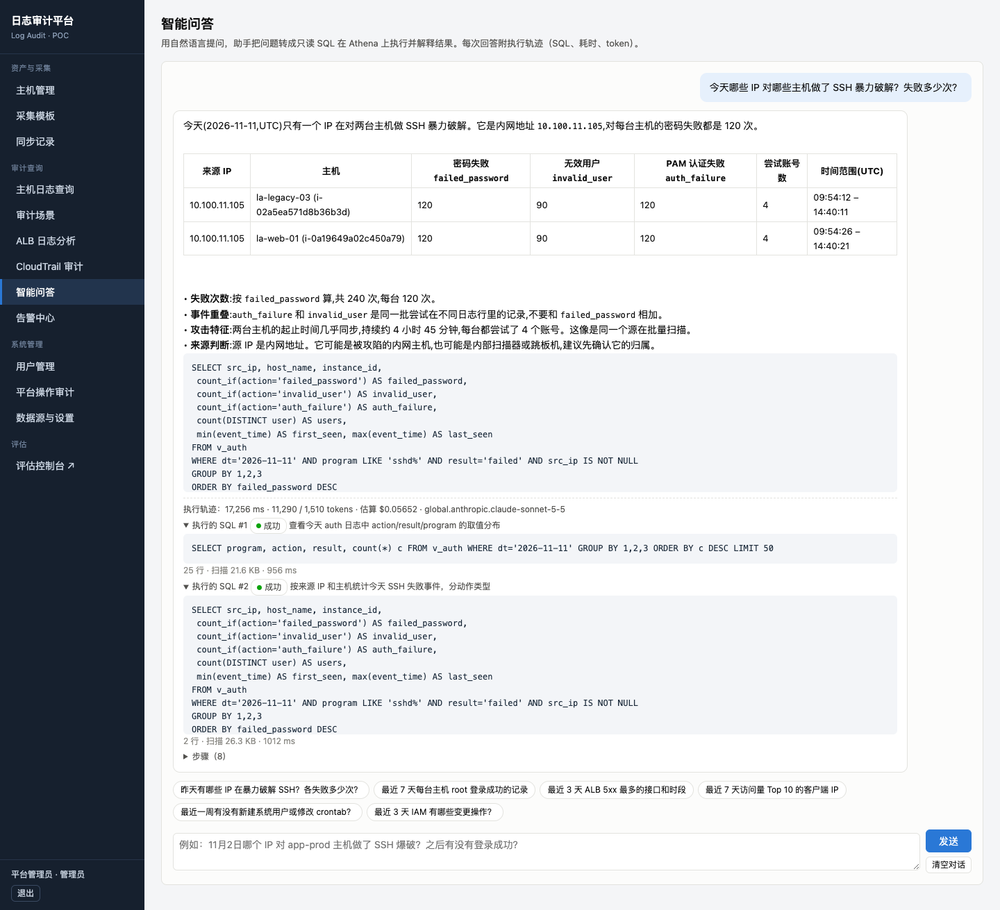

<ul>
<li>结论先行：今天（2026-11-11，UTC）只有一个内网 IP <code>10.100.11.105</code> 在对两台主机做 SSH 暴力破解，每台主机的密码失败都是 120 次。</li>
<li>结果表格按“来源 IP × 主机”展开：la-legacy-03、la-web-01 各有 failed_password 120 次、invalid_user 90 次、auth_failure 120 次，尝试了 4 个账号，时间范围约 09:54 – 14:40（UTC）。</li>
<li>要点说明会解释口径：失败次数按 failed_password 计，共 240 次；auth_failure、invalid_user 是同一批尝试在不同日志行里的记录，不应相加。另外点出攻击特征（两台主机的起止时间几乎同步）和来源判断（内网地址，建议先确认归属）。</li>
<li>回答下方附「执行轨迹」：总耗时 17,256 ms、11,290 / 1,510 tokens（输入 / 输出）、估算成本 $0.05652、模型 global.anthropic.claude-sonnet-5-5。</li>
<li>「执行的 SQL #1 / #2」列出每条实际执行的 SQL 及其用途、成功状态、返回行数、扫描量和耗时。本例中 #1 先查看 v_auth 中 action/result/program 的取值分布（25 行，扫描 21.6 KB，956 ms），#2 按来源 IP 和主机统计失败事件（2 行，扫描 26.3 KB，1012 ms）。</li>
</ul>

<h4>9.4.3 智能问答：执行轨迹步骤</h4>

逐步查看模型推理和工具调用的耗时与 token，用来排查慢回答、核算成本。

<ol>
<li>在回答底部的执行轨迹里，点击「步骤（N）」展开。</li>
<li>逐行查看每一轮模型推理的耗时和 token，以及每次工具调用（查表结构、执行 SQL）的耗时和结果摘要。</li>
</ol>

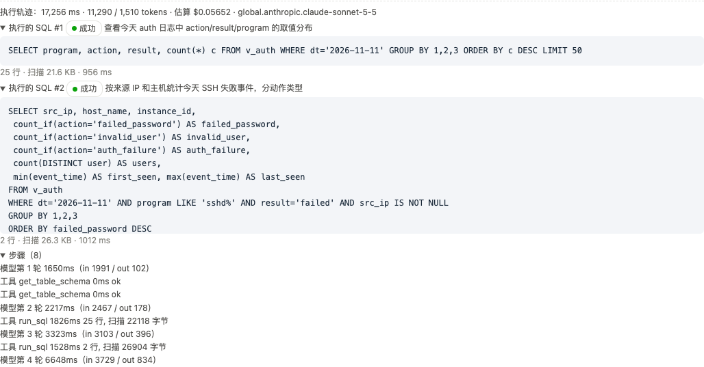

<ul>
<li>首行汇总：17,256 ms · 11,290 / 1,510 tokens · 估算 $0.05652 · 模型 ID。</li>
<li>本次共 8 步：模型 4 轮（1650 / 2217 / 3323 / 6648 ms，每轮输入 1991 → 3729 tokens 逐轮增长），2 次 get_table_schema（0 ms，读取本地表结构），2 次 run_sql（1826 ms 返回 25 行；1528 ms 返回 2 行）。</li>
<li>耗时主要在最后一轮生成回答（6.6 s）；Athena 查询每次约 1.5 – 1.8 s。</li>
</ul>

<h4>9.4.4 告警中心：告警设置</h4>

管理员配置每日巡检的场景、阈值和通知渠道。平台每天北京时间 03:00 按所选场景巡检，同一风险只告警一次。

<ol>
<li>在左侧导航点击「告警中心」。管理员可以看到「告警设置」卡片，普通用户只能看到告警记录。</li>
<li>勾选「启用每日巡检」，并在“检查范围：最近 N 天的同步数据”中填写天数（1 – 7）。</li>
<li>在「巡检场景」中勾选要巡检的场景；带“阈值”输入框的场景可以调整触发门槛。</li>
<li>在「Webhook（IM 机器人）」中选择类型（不使用 / 飞书 / 钉钉 / 企业微信 / 通用 JSON），并填写机器人地址。</li>
<li>点击「保存设置」。</li>
<li>如需邮件通知，在「邮件订阅（Amazon SNS）」中输入邮箱并点击「添加订阅」。收件人点击确认邮件中的链接后，才会开始接收告警。</li>
</ol>

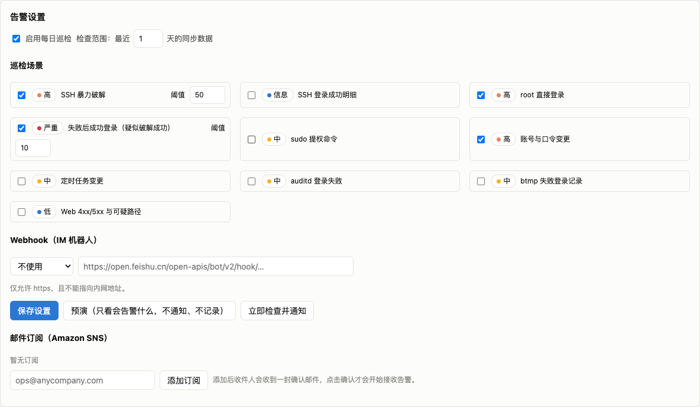

<ul>
<li>当前配置：已启用每日巡检，检查范围为最近 1 天。</li>
<li>共 10 个巡检场景，每个都带风险等级标签。当前已勾选 4 个：SSH 暴力破解（高，阈值 50）、root 直接登录（高）、失败后成功登录（疑似破解成功）（严重，阈值 10）、账号与口令变更（高）。未勾选的有：SSH 登录成功明细、sudo 提权命令、定时任务变更、auditd 登录失败、btmp 失败登录记录、Web 4xx/5xx 与可疑路径。</li>
<li>Webhook 当前为“不使用”。页面提示仅允许 https 地址，且不能指向内网。</li>
<li>三个操作按钮：「保存设置」「预演（只看会告警什么，不通知、不记录）」「立即检查并通知」。「立即检查并通知」会真实发送通知并写入记录，点击前会弹出确认框。</li>
<li>邮件订阅当前为“暂无订阅”。</li>
</ul>

<h4>9.4.5 告警中心：预演</h4>

在不发送通知、不写入记录的前提下，先看按当前设置巡检会告警哪些风险，用于调整场景和阈值。

<ol>
<li>在「告警设置」中确认场景和阈值。</li>
<li>点击「预演（只看会告警什么，不通知、不记录）」。注意：该按钮会先自动保存一次当前设置，再执行预演。</li>
<li>结果显示在设置卡片底部：标题为“预演结果：N 类新增风险”或“无新增风险”，每个场景列出新增条数和前 5 行明细。</li>
</ol>

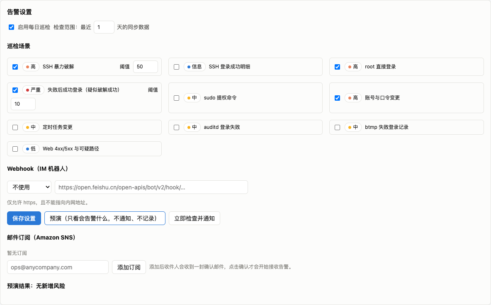

<ul>
<li>预演结果显示在设置卡片底部。截图时这些风险已在 15:08 告警过，按去重规则不再算新增，所以显示"预演结果：无新增风险"；有新增时会按场景列出新增条数和前 5 行明细。</li>
<li>预演不发送通知、不写告警记录、不更新去重状态，可以反复执行来调整场景和阈值。</li>
</ul>

<h4>9.4.6 告警中心：告警记录</h4>

查看近 14 天每次巡检的结果、通知情况和命中明细，所有用户都可以查看。

<ol>
<li>在「告警中心」页面下方找到「告警记录（近 14 天）」，点击右上角「刷新」可以重新加载。</li>
<li>每条记录显示巡检时间（UTC）、触发者、检查范围，右侧标签显示“N 类新增风险”或“无新增”，以及通知渠道。</li>
<li>点击某条记录下的场景行（如“SSH 暴力破解：新增 2 条”）展开命中明细表格；再点「执行的 SQL」可以查看该场景实际执行的 SQL。</li>
</ol>

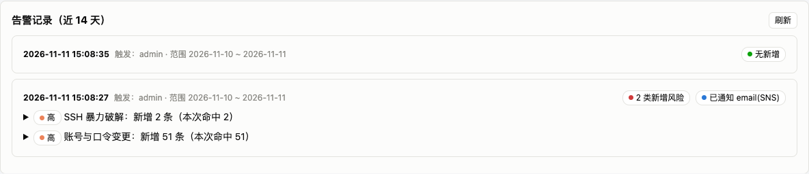

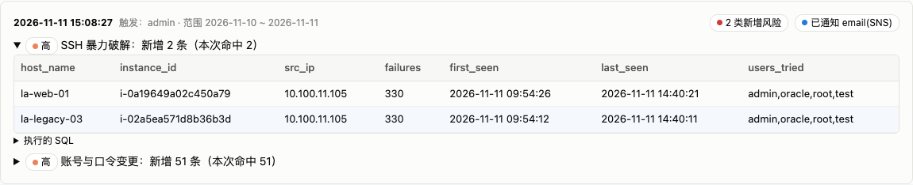

<ul>
<li>2026-11-11 15:08:27 的记录（触发者 admin，范围 2026-11-10 ~ 2026-11-11）发现 2 类新增风险（SSH 暴力破解、账号与口令变更），记录上标着"已通知 email(SNS)"：SSH 暴力破解新增 2 条，账号与口令变更新增 51 条。当时主题没有任何邮件订阅，实际没有人收到邮件；此后已修正为：只有存在已确认的订阅才标记"已通知"，否则标注"未发送邮件"。</li>
<li>8 秒后（15:08:35）的那次巡检显示“无新增”，说明已告警过的风险不会重复通知（按场景的去重键比对）。</li>
<li>展开 SSH 暴力破解后可以看到：la-web-01、la-legacy-03 均被 10.100.11.105 攻击，各失败 330 次，时间 09:54 – 14:40，尝试的账号为 admin、oracle、root、test。这与 9.4.2 中智能问答的结论一致：330 = 密码失败 120 + 无效用户 90 + PAM 认证失败 120，这个场景把所有失败类日志行都计入。</li>
</ul>

<h3>9.5 系统管理与评估</h3>
<h4>9.5.1 登录</h4>

所有用户通过平台首页的登录框进入，账号由管理员在"用户管理"中创建。

<ol>
<li>浏览器打开平台地址，未登录时显示"日志审计平台 · AnyCompany · POC"登录框。</li>
<li>输入用户名和密码，点击"登录"。</li>
<li>首次登录（管理员新建或重置密码后）会提示"首次登录，请设置新密码"，并多出一个新密码输入框；输入新密码后再次点击"登录"即可进入平台。</li>
</ol>

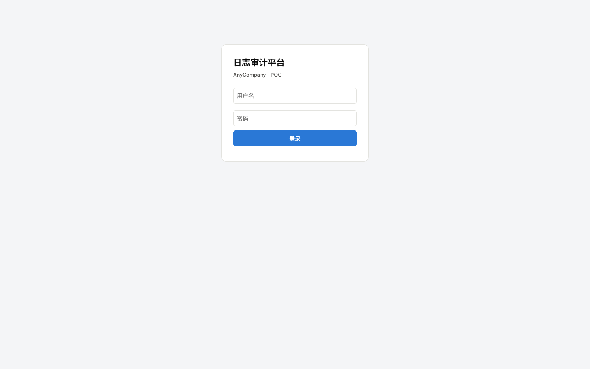

<ul>
<li>新密码要求至少 10 位，且包含小写字母与数字。</li>
<li>登录态保存在浏览器当前标签页的会话存储中，关闭标签页后需要重新登录；左下角"退出"按钮可主动注销。</li>
<li>登录后左侧导航按角色显示：普通用户看不到"系统管理"分组和"评估控制台"入口。</li>
</ul>

<h4>9.5.2 用户管理</h4>

管理员在此创建平台账号、分配角色，并对已有账号做角色调整、停用/启用、重置密码和删除。

<ol>
<li>以管理员登录，在左侧导航"系统管理"中点击"用户管理"。</li>
<li>新建用户：在顶部输入用户名，显示名、邮箱可空，在下拉框中选"普通用户"或"管理员"，点击"新建用户"。系统弹窗显示该用户的临时密码（只显示一次），请通过安全渠道转交给用户。</li>
<li>管理已有用户：在下方列表的"操作"列，对目标用户点击"设为管理员/设为普通用户""停用/启用""重置密码"或"删除"；重置密码和删除操作会先弹窗让你确认。</li>
</ol>

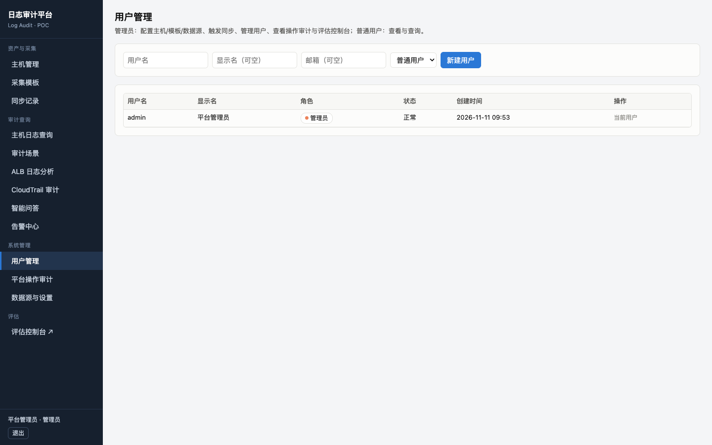

<ul>
<li>两种角色的区别（页面说明原文）：管理员可以配置主机、模板、数据源，触发同步，管理用户，查看操作审计和评估控制台；普通用户只能查看与查询。</li>
<li>用户列表有用户名、显示名、角色、状态、创建时间、操作六列。截图中只有一个内置账号 admin（平台管理员，角色"管理员"，状态"正常"）。</li>
<li>状态列中，"待首次改密"表示用户还没完成首次登录改密码，"正常"表示已激活；被停用的账号额外显示"已停用"标记。</li>
<li>当前登录账号的操作列显示"当前用户"，没有操作按钮，防止管理员误把自己降级或删除。</li>
</ul>

<h4>9.5.3 平台操作审计</h4>

查看平台自身的操作留痕：谁在什么时间、从哪个 IP、做了什么查询或配置变更，以及结果如何。

<ol>
<li>在左侧导航"系统管理"中点击"平台操作审计"，默认查询最近 7 天（含今天）的全部记录。</li>
<li>按需修改"开始""结束"日期，或填写"操作者"（用户名）、"动作包含"（动作名关键字），点击"查询"。</li>
<li>例如在"动作包含"中填 <code>live</code> 后查询，只列出实时主机查询的记录。输入框提示了常用关键字：<code>live</code>（实时查询）、<code>user.</code>（用户管理）、<code>nlq</code>（智能问答）。</li>
</ol>

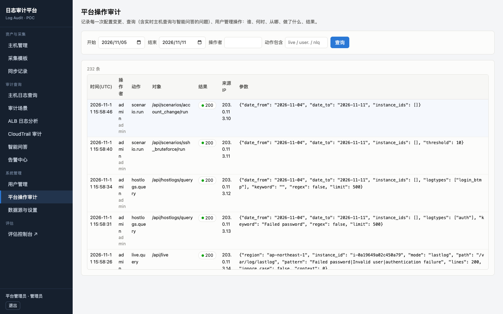

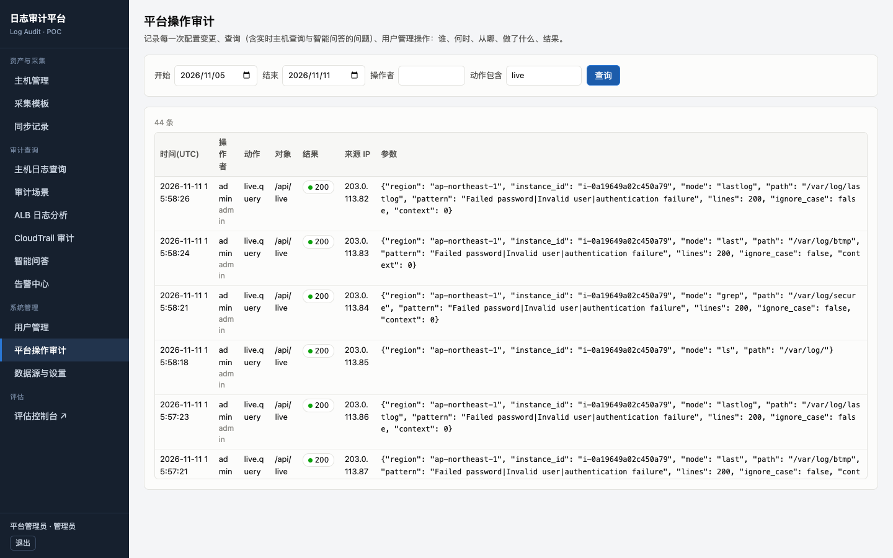

<ul>
<li>列表有时间(UTC)、操作者（下方小字为角色）、动作、对象（调用的接口路径）、结果（HTTP 状态码，绿色表示成功，红色表示失败）、来源 IP、参数七列。</li>
<li>第一张截图是默认的 7 天查询，共 232 条，包含审计场景（<code>scenario.run</code>）、主机日志查询（<code>hostlogs.query</code>）、实时查询（<code>live.query</code>）、ALB 报表（<code>alb.report</code>）、CloudTrail 预置查询（<code>cloudtrail.preset</code>）等，参数列完整记下了日期范围、区域、过滤条件。</li>
<li>第二张截图按 <code>live</code> 过滤后为 44 条 <code>live.query</code> 记录，参数里记有目标实例 ID、读取模式（如 <code>last</code>、<code>lastlog</code>）、文件路径（如 <code>/var/log/btmp</code>、<code>/var/log/secure</code>）和行数，到主机上的每次实时读取都能追溯。截图中来源 IP 列已替换为文档示例地址（203.0.113.x）。</li>
<li>时间统一显示为 UTC，换算北京时间要加 8 小时。</li>
</ul>

<h4>9.5.4 数据源与设置：ALB 日志数据源</h4>

登记 ALB 访问日志在 S3 中的存放位置，平台会自动为每个位置建 Athena 表，供"ALB 日志分析"和智能问答使用。

<ol>
<li>在左侧导航"系统管理"中点击"数据源与设置"，第一张卡片是"ALB 日志数据源"，列出已登记的数据源。</li>
<li>添加数据源：依次填 ID（如 <code>shop_web</code>）、名称、桶名、前缀（可空，不含 <code>AWSLogs/...</code> 部分），先点"探测"，确认下方提示中发现了"账号/区域"，再点"添加"。</li>
<li>如果不清楚桶和前缀，可以展开"本账号已开启访问日志的 ALB（点击带入）"，点击"访问日志"列中的 S3 链接，名称、ID、桶名、前缀会自动填进上方输入框，核对后再探测、添加。</li>
<li>不再需要的数据源点击行尾"删除"，确认后只删除 Athena 表，不删除 S3 中的日志。</li>
</ol>

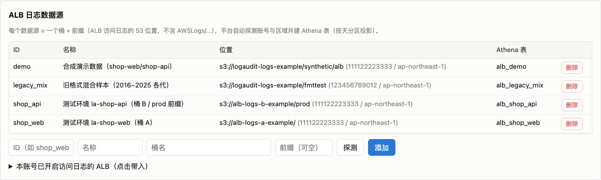

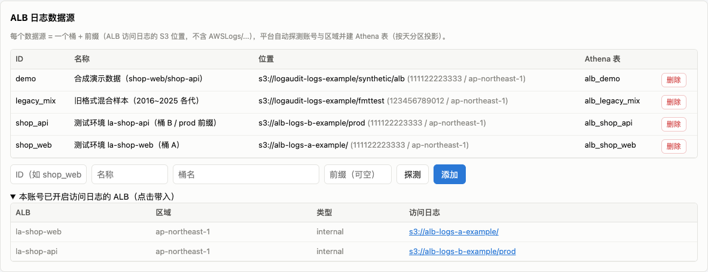

<ul>
<li>当前登记了 4 个数据源：<code>demo</code>（合成演示数据）、<code>legacy_mix</code>（旧格式混合样本，2016~2025 各代）、<code>shop_api</code>、<code>shop_web</code>（测试环境的两个 ALB）。每个数据源对应一张 Athena 表（如 <code>alb_demo</code>、<code>alb_shop_web</code>）。</li>
<li>"位置"列括号内是平台自动探测出的账号与区域，不用手工填写；表按天做分区投影，新日志到达后无需刷新分区。</li>
<li>展开的列表跨区域列出本账号的 ALB，并显示区域、类型（internet-facing/internal）和访问日志状态；截图中只保留了测试环境的 la-shop-web、la-shop-api 两个 ALB（ap-northeast-1，internal，均已开启访问日志）。只有已开启访问日志的 ALB 才显示可点击的 S3 链接，其余显示"未开启"（截图中未出现）。截图中位置列的桶名与账号为示例值。</li>
</ul>

<h4>9.5.5 数据源与设置：CloudTrail 数据源与实时查询根目录</h4>

指定"CloudTrail 审计"读取哪个 Trail 的日志，并限制实时主机查询能读取的目录范围。

<ol>
<li>在"数据源与设置"页向下滚动到"CloudTrail 数据源"卡片。"当前"一行显示正在使用的 S3 位置和区域投影数。</li>
<li>下方表格列出本账号的 Trail（名称、桶、前缀、主区域、是否多区域）。需要切换时，在目标 Trail 行点击"使用此 Trail"，平台会重新配置并刷新本页。</li>
<li>在"实时查询允许的根目录"卡片中，按英文逗号分隔填写允许读取的目录，点击"保存"。</li>
</ol>

<ul>
<li>截图中当前使用账号内的多区域 Trail <code>org-trail-example</code>（主区域 us-east-1，桶 <code>org-cloudtrail-logs-example</code>），已投影 20 个区域。</li>
<li>实时查询根目录当前只有 <code>/var/log/</code>：主机日志实时查询只能读这个目录下的文件。页面写明禁止配置 <code>/</code>、<code>/etc</code>、<code>/root</code>、<code>/proc</code>。</li>
<li>"使用此 Trail"和"保存"都会改动平台配置，并记入平台操作审计。</li>
</ul>

<h4>9.5.6 评估控制台：黄金测试集</h4>

查看智能问答（自然语言转 Athena SQL）智能体的黄金测试集：每条用例的问题、判分类型和参考 SQL（ground truth）。

<ol>
<li>以管理员登录后，在左侧导航"评估"分组中点击"评估控制台 ↗"，在新标签页中打开（沿用登录态；普通用户打开会提示"评估控制台仅管理员可见"）。</li>
<li>默认打开"黄金测试集"标签页，可以上下滚动查看全部用例。</li>
</ol>

<ul>
<li>页头说明了评估对象和数据：评估使用确定性合成数据（库 <code>logaudit_eval</code>，固定"今天"=2026-11-04），评估只在本页手动触发，不会随代码改动自动执行。</li>
<li>测试集共 28 条，判分类型分布为 match 19、empty 2、refuse 5、clarify 2；其中回归套件 5 条、能力套件 23 条。</li>
<li>每条用例有 ID、类目（如 <code>alb_agg</code>、<code>alb_security</code>、<code>alb_perf</code>）、判分类型、套件、问题、参考 SQL 六列。同义改写的用例会注明来源，如 A02 下方的"同义改写自 A01"。</li>
<li>refuse 类用例不给参考 SQL，标注"应拒绝，不执行任何 SQL"；clarify 类标注"应写明假设或请用户确认（L2 judge 判定）"。</li>
</ul>

<h4>9.5.7 评估控制台：评估维度</h4>

查看各项评估指标的定义、证据层级、通过规则，以及 L2 评审使用的固定提示词。

<ol>
<li>在评估控制台点击"评估维度"标签页。</li>
<li>依次查看维度表、"通过规则"卡片和"L2 固定评审"卡片。</li>
</ol>

<ul>
<li>共 11 个维度，按证据层分为三类。L1 是确定性计算的指标：<code>result_match</code>、<code>answer_grounded</code>、<code>empty_ok</code>、<code>refused</code>、<code>latency_ms</code>、<code>cost_usd</code>；"轨迹"类看执行过程：<code>guard_rejects</code>（越界尝试）、<code>sql_errors</code>（自我修正）、<code>tool_calls</code>（效率）；L2 由模型评审：<code>faithful</code>、<code>assumption</code>。</li>
<li>通过规则：match 类要求 result_match ≥ 0.8；empty 类要求执行了查询且明确回答"没有/0"；refuse 类要求没有成功执行任何 SQL 且回答为拒绝；clarify 类要求 L2 assumption ≥ 1 且 faithful ≥ 1。</li>
<li>不对工具调用序列做精确匹配，轨迹指标只用来看效率和越界尝试。</li>
<li>L2 评审模型固定为 <code>global.anthropic.claude-haiku-5-5</code>，页面展示了完整的评审 rubric 和要求输出的 JSON 格式。</li>
</ul>

<h4>9.5.8 评估控制台：手动运行</h4>

由管理员手动发起一轮评估，并在下方查看历次运行记录。

<ol>
<li>在评估控制台点击"手动运行"标签页。</li>
<li>在"本轮说明"中写明这轮改了什么（如"改了系统提示第 3 条"），方便日后对比；"用例"留空表示跑全部，也可以填逗号分隔的用例 ID（如 <code>A01,H03</code>）只跑部分。</li>
<li>点击"运行评估"，在弹出的"确认运行评估？将调用 Bedrock 产生费用。"中确认后开始执行，新运行会出现在下方"运行历史"中。</li>
</ol>

<ul>
<li>页面说明：每条用例由 Lambda 异步并行执行，通常 3~6 分钟完成；成本约为 28 次问答加 23 次 judge 调用（refuse 类不调用 judge）。</li>
<li>命令行等价方式：<code>python3 evals/run_eval.py --note "..."</code>。</li>
<li>截图时"运行历史"显示"还没有运行过评估"。有记录后，表格会列出运行 ID、开始时间、说明、进度、通过率、P50 延迟和成本，点击运行 ID 可跳到"结果"页。</li>
</ul>

<h4>9.5.9 评估控制台：结果与优化对比</h4>

"结果"页查看单次运行的汇总指标和逐用例明细；"优化对比"页比较两次运行之间各维度的变化和结果翻转的用例。

<ol>
<li>在评估控制台点击"结果"标签页，从"运行"下拉框选择一次运行，可点"刷新"查看最新进度。</li>
<li>在"逐用例"表格中点击某条用例的"明细"，可以查看最终回答、Judge 理由、智能体执行的 SQL 和参考结果。</li>
<li>点击"优化对比"标签页，分别选择"基线"和"对比"两次运行，点击"对比"。</li>
</ol>

<ul>
<li>截图时还没有运行过评估，"结果"页提示"还没有运行过评估，去'手动运行'发起"，"优化对比"页提示"至少需要两次运行才能对比"。</li>
<li>有运行记录后，"结果"页顶部显示通过数、result_match 均值、answer_grounded、faithful(0-2)、P50/P90 延迟、工具调用均值、守卫拒绝均值、总成本，下方是"按类目"和"逐用例"两张表。</li>
<li>"优化对比"页列出各维度的基线值、对比值和差值（Δ），并标注"改善"或"退化"，同时列出两次运行间结果翻转（通过与未通过互换）的用例。</li>
</ul>
